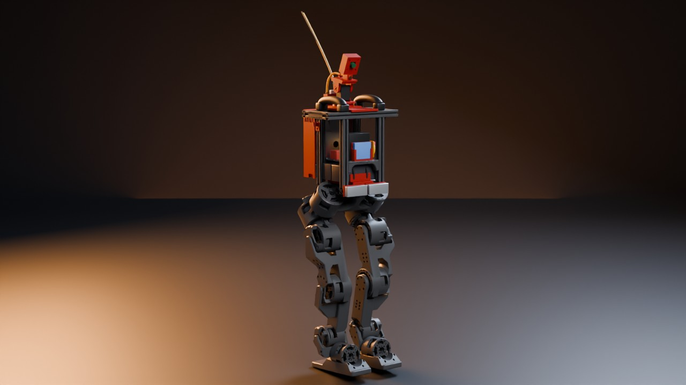
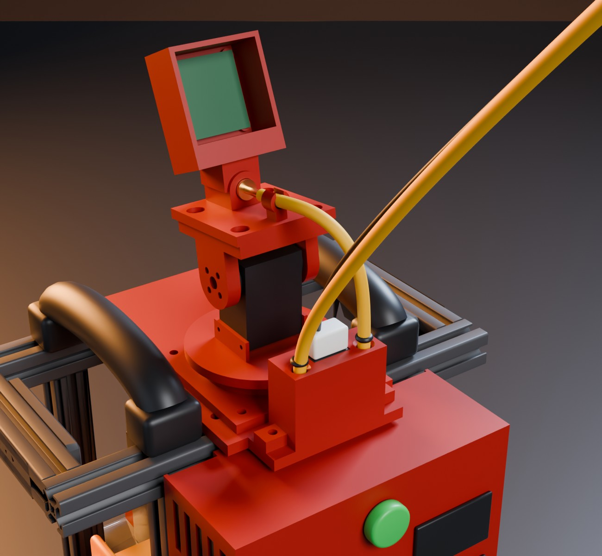
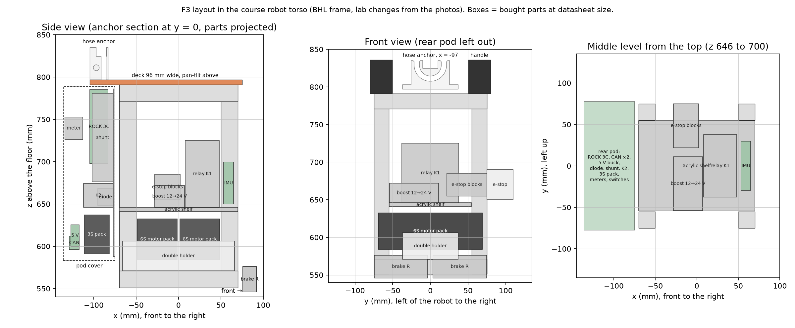

# Final design F3



This folder places every part of the course bill of materials (BOM) in the course robot torso.
In F3 a trolley carries the water tank and the pump. A teammate pushes it behind the robot, like a hospital IV stand.
Only the delivery hose comes down from the trolley boom to the robot.
A printed hose anchor at the rear of the deck holds the hose end and the plug of the pump signal cable.
The pan-tilt with two ST3215 servos carries the nozzle and the Arducam B0201 camera on top of the torso.
The print kit for the hardware team is in [`kit/`](kit/README.md).

Status: the CAD and the print kit are **built**. The checks are **tested in simulation**: they run on the CAD geometry and the Berkeley Humanoid Lite (BHL) meshes. Nothing here is printed or measured.

**Open:** The trolley design (`docs/hardware/trolley.md`) proposes a 3 × 6 mm silicone hose and a JST SM 2-pin connector for the plug J10. The hose anchor fits a hose of 6 mm outer diameter and a plug body of about 20 × 12 × 10 mm. Change `HOSE_OD` and `PLUG` in `kit.py` if the parts change.

**Open:** The 2 rear deck screws sit at x −60, y ±40. The pan base shelf (x −78 to 2, y −40 to 40) covers the inner half of each screw head. The checks do not model screw heads. Fix this in the CAD before you print the deck and the pan base.

**Open:** The deck holds the 4 M4 nuts of the pan base in pockets that open to the top face. So the 4 screws clamp the pan base to its nuts, not to the deck. Only its weight holds the pan-tilt on the deck. Fix this before you print the deck, for example with M4 heat-set inserts in the deck.

**Open:** The deck sits 2.5 mm above the pod cover. The cover hooks need 8 mm to come off the plate edge. So hang the cover before you fasten the deck. To open the pod later, take off the pan-tilt and the deck first.

**Assumed:** The course torso is the BHL torso. We checked this on 13 photos of the lab's prototype. The 2020 frame, the double top rails, the battery holder and the 45° hip actuators match. The lab made four changes. It removed the shoulder actuators and added two carry handles on the side top rails. It put the relay on the middle shelf (the BHL PC shelf). It put the computer at the top level and the e-stop on the left side.

**Assumed:** The battery positions are our proposal. The course has not published where its three batteries go.

**Assumed:** The hose end weighs 20 g on the robot. The 0.24 m of hose with water from the anchor to the nozzle weighs 8 g. The free hose to the boom adds about 10 g. The two halves of J10 and the cable ends weigh 10 g.

**Not verified:** The two zip tie stops of the hose anchor hold a pull of 20 N. The kit gives a bench test (kit step 70).

**Not verified:** The handle size (about 30 mm thick, 45 mm high, inner gap about 100 mm) comes from the photos. Measure it on the robot before you print the deck.

**Not verified:** The robot needs the software knee limit of 1.4 rad. Over the full URDF knee range, the foot touches a 6S pack end, the holder and the pod cover (0.1 to 0.2 mm).

## Terms

- **Delivery hose:** the silicone tube from the pump on the trolley to the nozzle. The CAD uses the 3 × 6 mm tube of `docs/hardware/water.md` (3 mm bore, 6 mm outside).
- **Hose anchor:** the printed strain relief on the deck tongue. The hose runs through a U-turn inside it. A zip tie around the hose above each opening stops the hose.
- **Rear pod:** a 2 mm aluminium plate on the rear posts, outside the frame. It carries the computer, the 3S pack and the small electronics, under a printed cover.
- **Robot frame:** x forward, y left, z up, in mm, feet on the floor. The top of the torso frame is at z = 791.
- **Trolley:** a wheeled stand like a hospital IV stand. It carries the water tank and the pump high up. Its boom holds the hose above and behind the robot.

## Hose anchor



Figure 1. Hose anchor on the deck tongue, seen from the rear left. The hose comes down from the trolley boom into the opening on the robot's left side. It leaves the opening on the right side in a loop to the head. The white box is the trolley plug on the robot plug.

We put the anchor at the rear of the deck, not on a handle, for three reasons:

- The deck is our part, so we know its size. The handles are lab parts. Their size comes from photos only.
- The lab hangs the robot from the handles with chains (photos). An anchor on a handle would be in the way.
- On the centre line, the hose loop is the same for a pan to the left and a pan to the right.

The deck has no free room at the rear for its own screws: the pan base shelf covers it.
The pan base screws cannot take the anchor either, because they do not hold the deck (see the **Open** note above).
So F3 adds a tongue at the rear centre of the deck (x −104.5 to −83, y −37 to 37). Like the rest of the deck, it sits 2.5 mm above the pod cover.
Two M4 × 12 screws fasten the anchor to the tongue, into nuts in pockets under the tongue.
A pull on the hose goes from the anchor into the deck and its 4 M5 screws, then into the top rails. It does not go through the pan-tilt.

| Item | Value |
|---|---|
| Size and mass | 21.5 × 74 × 38 mm (x, y, z), 32 g at 40 % infill, 1 h 51 min of printing |
| Hose path | Down into the left opening (boom side, y 18). Through a U-turn: bend radius 18 mm, bore 7 mm. Up out of the right opening (head side, y −18). |
| Openings | top face at z 835, x −97, with a 1.5 mm chamfer |
| Hose stops | one zip tie around the hose just above each opening |
| Plug pocket | 12.3 × 20.3 × 10.5 mm between the openings, open at the top. A 6 mm hole takes the robot cable down through the anchor, the tongue and an 8 mm hole in the pod cover top. |
| Loop to the head | about 140 mm of hose from the right opening to the rear hose clip of the head |

The anchor top is at z 835 and its openings are at x −97, for this reason. When the head tilts 45° up, its rear comes back to x −87 and down to z 845.

**Assumed:** The loop is 1.5 times the longest straight distance from the right opening to the rear hose clip of the head. That distance is 93 mm within the pan limits (−90° to 90°) and the tilt limits (−40° to 45°) of `robot/config.toml`.

## Files

| File | What it does |
|---|---|
| `parts.json`, [`parts.md`](parts.md) | Size, mass, mounting and power facts of every BOM part, with the source of each value |
| `tank.py` | F3: builds the deck with the anchor tongue. Checks bed fit, the closed mesh and the pan-tilt clearance to the handles. Writes `out_f3/deck_f1.*` and `out_f3/deck.json`. F2 and F1: also builds the tanks. |
| `kit.py` | Builds every printed part, the two cut drawings, `kit/print_sheet.md` and `kit/hardware.md`. Checks bed fit, closed meshes, walls, fit to the bought parts, solid collisions, torso clearance, the camera view and the hose anchor. Writes `out_f3/kit.json`. |
| `layout.py` | Reads `kit.json`. Checks all gaps (parts, torso mesh, legs), sums the mass and writes `out_f3/layout.json` |
| `views.py` | Draws the labelled section views `out_f3/layout_views.png` |
| `render.py` | Blender renders in `renders/`: `f3_*.jpg` and `turntable_f3.jpg` |
| `out_f3/` | In the repository: `deck.json`, `kit.json`, `layout.json`, `layout_views.png` and `deck_f1.stl`. The steps below also write STEP files and reference shapes here. |
| `out_f2/` | Design F2 with two R2 water tanks. `sim/water/water.py` still reads it (`sim/mission` and `sim/payload` no longer do; the F2 BHL models are in `archive/payload_bhl/models.py`). |

`DESIGN=F2` in front of steps 1 to 5 builds the design F2 into `out_f2/` and `kit_f2/`. It overwrites the files that the simulations read, so do it only when F2 changes.
`DESIGN=F1` builds the old design F1 (one tank inside the torso) into `out/` and `kit_f1/`.
The folders `kit_f2/`, `out/` and `kit_f1/` are not in the repository.

## Run

Run all commands from the repository root, in this order: each step reads the output of the step before it.
The BHL meshes must be in `third_party/` (`scripts/fetch_bhl_assets.sh`).

1. Build the deck (5 s):

```
uv run --project cad python cad/final/tank.py
```

2. Build the print kit and run its checks (1 min):

```
uv run --project cad --with matplotlib python cad/final/kit.py
```

3. Run the layout checks (3 to 5 min):

```
uv run --project cad python cad/final/layout.py
```

4. Draw the section views:

```
uv run --project cad --with matplotlib python cad/final/views.py
```

5. Render the stills with Blender (4 min on an RTX 3090 that also runs a training job). Add `turntable_f3` at the end for the turntable video. `TMPDIR` holds the video frames (150 MB). Add `TT_STILL=1` in front to render only the first frame of the turntable. Add `F1_CPU=1` when the GPU is busy.

```
TMPDIR=$HOME/.cache PARTS_DIR=out_sts3215 blender -b --factory-startup -P cad/final/render.py -- third_party/berkeley-humanoid-lite-assets/data/robots/berkeley_humanoid/berkeley_humanoid_lite cad/final/renders
```

`kit.py` and `layout.py` stop with a list of failures. `layout.py` fails in these cases:

- two parts are less than 1 mm apart,
- a part is less than 1 mm from the torso mesh,
- a part is 10 mm or less from a leg, with the knee limited to 1.4 rad.

`kit.py` also fails when the hose anchor comes within 2 mm of the moving pan-tilt parts or within 5 mm of a handle.

## Layout



Figure 2. Side view, front view and the middle level from the top. The boxes are the bought parts at datasheet size. The side view cuts the hose anchor at y = 0. The front view cuts it at x = −97 and shows the U-turn.

| Level | Parts | Mass |
|---|---|---|
| Bottom, z 545 to 633 | Two Zeee 6S packs (138 × 47 × 48.5 mm) side by side in the printed double holder, on the bottom rails, two straps. Two brake resistors on the front face of the front bottom rail. | 1.41 kg |
| Middle shelf, z 641 to 725 | 5 mm acrylic shelf (140 × 109 mm) on the PC shelf bracket bars. Relay K1 upright at the front, boost converter, e-stop contact blocks at the left (z 655 to 685), IMU in its mount at the front. | 0.67 kg |
| Rear pod, x −136 to −75 | Plate: diode, shunt, ROCK 3C (upright, ports down), relay K2. Basket: 3S pack, 2 CANables, 5 V buck converter, one empty rail pocket. Cover: 3 meters, 2 switches. | 1.17 kg |
| Top of the torso | Deck 96 mm wide with the anchor tongue, ST3215 pan-tilt, head with the B0201 camera and the nozzle, hose anchor, hose end and signal plug | 0.57 kg |
| Wiring and clips | lumped at the torso centre (guess) | 0.32 kg |

The parts add 4.14 kg, with their centre of mass at x −26.8, y 1.0, z 666 mm.
On the ASMR robot (`source/robot_models`, MJCF) the bare robot weighs 12.21 kg and the robot with these parts weighs 16.35 kg.
In the standing pose, the centre of mass of the whole robot is 0.43 m above the floor without the parts and 0.49 m with them
(x −43 mm, y 0 mm). We computed this with `sim/payload/stability.py` (`static_rows()`, payload `f3` of `source/robot_models/robots/asmr2026_payload.py`).
Older numbers on the BHL model (kept for the history, `archive/payload_bhl/models.py`): we took the BHL battery (603 g) and the BHL computer (280 g) out of the BHL torso mass, the robot weighed 14.60 kg (bare biped 11.34 kg), its centre of mass was 0.43 m high; F2 with full tanks: 15.99 kg and 0.45 m.

The e-stop is back at the lab's place on the left side face: centre x −13, z 670. F2 moved it 50 mm up, because the left tank covered this place.
The nozzle tip is at z 892.5 mm with the tilt at 0.

## Checks (tested in simulation)

| Check | Result |
|---|---|
| Print pieces | All fit a 220 × 220 × 250 mm bed. All are one closed mesh. All walls are 2 mm or more. |
| Printed and bought parts as solids | No overlap |
| Parts against parts (boxes) | All gaps 1 mm or more. Smallest: 3.0 mm (the two 6S packs, across the divider), 4.0 mm (shelf to IMU, CANable to CANable). |
| Parts against the torso mesh | Smallest gap 1.5 mm (6S packs, holder and pod spacers to the posts). The Zeee straps come within 0.4 to 1.0 mm of the bracket tongues. A soft strap may touch. |
| E-stop at z 670 | 6.0 mm to relay K1, 9.0 mm to the shelf, 17.1 mm to the torso mesh |
| Legs, knee ≤ 1.4 rad | Smallest gap 43 mm (brake resistors). Holder 44 mm, pod cover 48 mm, 6S pack 55 mm. The e-stop is never within 60 mm. |
| Legs, full URDF range | 0.1 to 0.2 mm (a 6S pack end, the holder and the pod cover): the foot folds up behind the hip at knee 2.4 rad. The e-stop stays more than 50 mm away. So F3 still needs the knee limit of 1.4 rad. |
| Pan-tilt to the handles over a full pan turn | 12.0 mm |
| Hose anchor to the moving pan-tilt parts, full pan turn, tilt −40° to 45° | 7.0 mm (to the pan yoke) |
| Hose anchor to the handles and to the screw heads on the deck | 29.1 mm and 11.1 mm |
| Hose 25 mm straight up from each anchor opening to the moving parts, pan −90° to 90°, tilt −40° to 45° | 9.6 mm |
| Nozzle tip in the camera image | 92° off the camera axis (below and behind the lens). The half view is 40°. |

The gap values change by about 0.1 mm from run to run, because the checks sample random points on the meshes.
The loop of hose between the anchor and the head is free. The checks do not model it.

## Open points

- Where does the course put its three batteries? If the layout of the teaching assistant (TA) differs, change the parameters in `kit.py` and run the steps again.
- The Korean shop link for the 6S pack is not the Zeee. It is a VEGA 5200 mAh pack (154 × 51 × 44 mm, 751 g). Print `holder_6s_vega` for it. It adds 0.3 kg. Its ends are 1 mm from the bracket tongues.
- The Waveshare servo adapter has no place in the CAD yet. The fourth rail pocket on the basket lip is free for a small board. The opto-isolator U8 of the pump switch now sits on the trolley.
- `docs/hardware/electrical.md` proposes a fourth e-stop contact block (NC4) for the pump loop. The CAD box of the contact blocks holds 3 blocks and is 11 mm from the boost converter. Check the depth of the 4 blocks before you fit them.
- Check the hose loop on the robot over the full pan and tilt range before the first spray (kit step 67). The trolley boom must stay behind the robot. A hose that hangs straight down can touch the camera box when the head tilts up.
- Test the grip of the hose anchor with 20 N on the boom side of the hose (kit step 70).

## Older designs

- F2: two printed R2 water tanks on the side faces of the torso posts, the pump on the middle shelf, the e-stop 50 mm higher. Build it with `DESIGN=F2`. Renders: `renders/f2_*.jpg`.
- F1: one R1F tank inside the torso. Build it with `DESIGN=F1`.

## Licence

Code: MIT. CAD files, drawings and renders: CC BY-SA 4.0.
The renders show the BHL meshes (CC BY-SA 4.0). Credit the Berkeley Humanoid Lite team and use the same licence when you share them.
