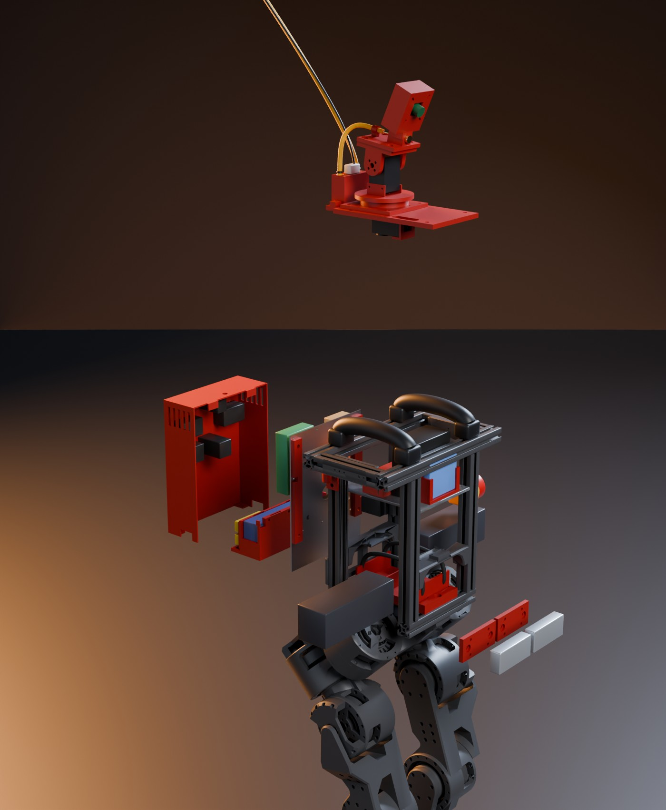
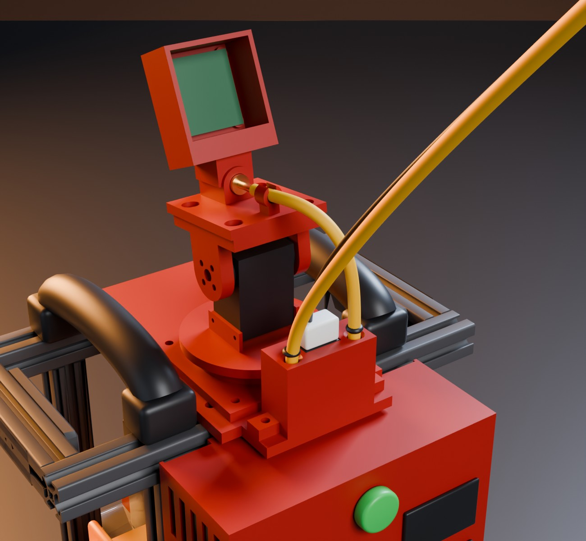
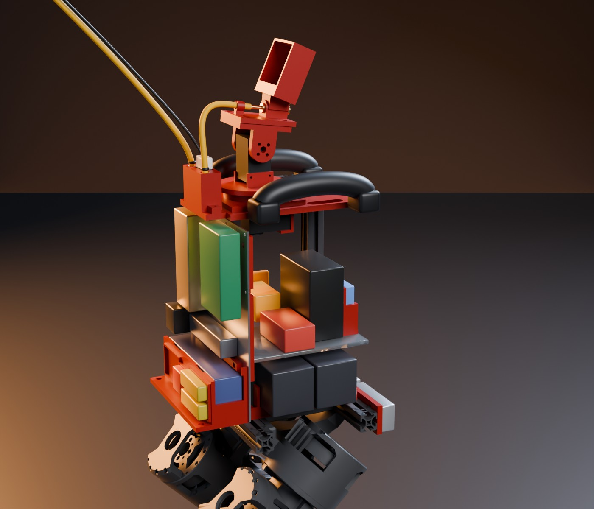
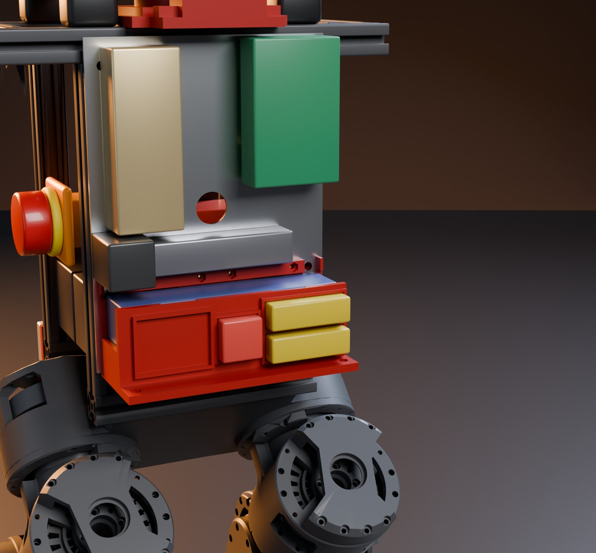
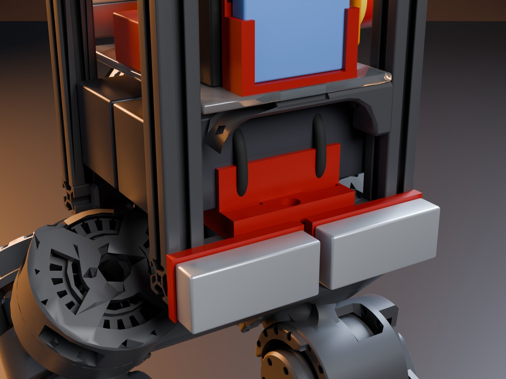
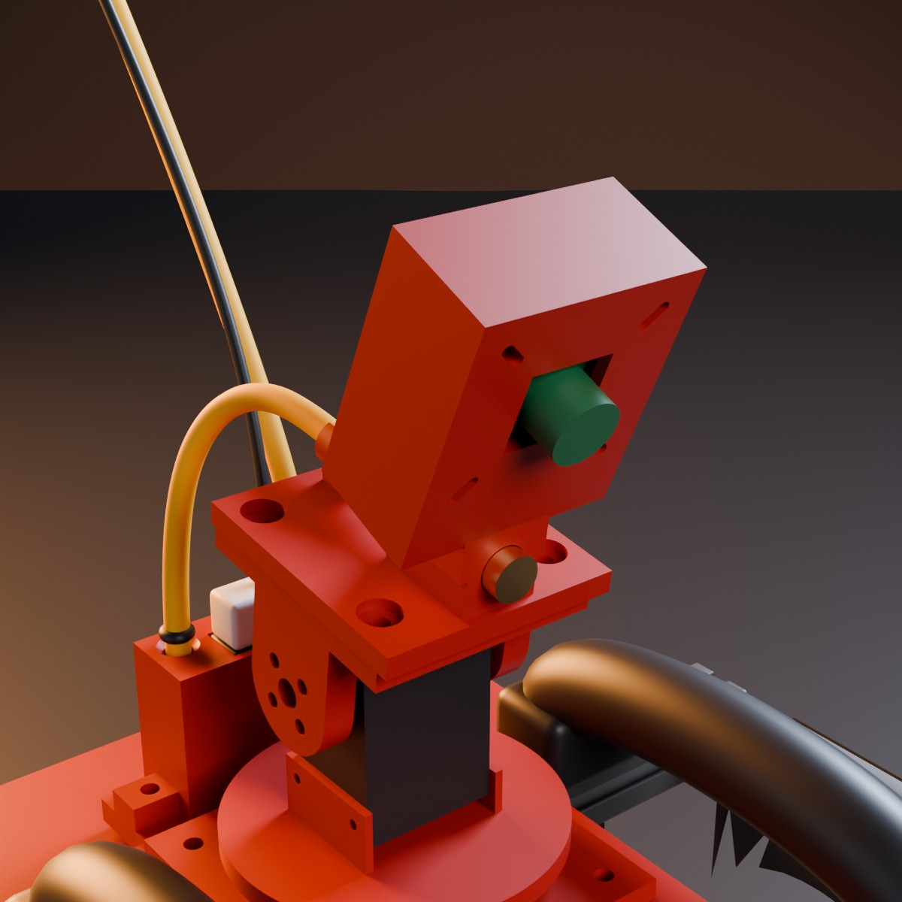

# F3 print kit

This folder is the print kit of the final design F3 for the hardware team.
It has the print files, the cut drawings, the print sheet, the hardware list and the assembly steps.
In F3 the water tank and the pump hang on a trolley. The robot carries no tank and no pump. Do not print the tanks of F2.

Status: the CAD is **built**. The checks are **tested in simulation** (CAD geometry, Berkeley Humanoid Lite (BHL) meshes, leg sweep). Nothing is printed, cut or measured.

`cad/final/kit.py` makes every file in this folder except this README. Do not edit those files by hand. Change the parameters in `kit.py` and run the steps of [`cad/final/README.md`](../README.md#run) again.

**Open:** The trolley design (`docs/hardware/trolley.md`) proposes the delivery hose and the plug J10 of the pump signal cable. Read the hose note before step 60.

**Open:** The 2 rear deck screws (x −60, y ±40) sit under the edge of the pan base shelf. The shelf covers the inner half of each screw head. The checks do not model screw heads. We will fix this in the CAD before the deck and the pan base are printed.

**Open:** The deck holds the 4 M4 nuts of the pan base in pockets that open to the top face. So the 4 screws clamp the pan base to its nuts, not to the deck. Only its weight holds the pan-tilt on the deck. We will fix this before the deck is printed.

**Open:** The deck sits 2.5 mm above the pod cover, so the cover can only go on before the deck (step 43). To open the pod later, take off the pan-tilt and the deck first.

**Open:** The Waveshare servo adapter has no place in the CAD yet.

**Open:** `docs/hardware/electrical.md` proposes a fourth e-stop contact block (NC4). The CAD box of the contact blocks holds 3 blocks and is 11 mm from the boost converter. Check the depth of the 4 blocks before you fit them.

**Not verified:** These sizes come from listings, photos or guesses. Measure the parts before you print the part that holds them:

| Part | What to measure | Printed part | Parameter in `kit.py` |
|---|---|---|---|
| Delivery hose | outer diameter (6 mm assumed) | `hose_anchor`, `head_f1`, `hose_clip` | `HOSE_OD` |
| Plug J10 of the pump signal cable (JST SM 2-pin, proposed) | body size (the pocket takes up to 20 × 12 × 10 mm) | `hose_anchor` | `PLUG` |
| Brake resistor RH50C4R70J | hole pattern (39.7 × 21.4 mm assumed) | `resistor_mount_*` | `RES_HOLES` |
| B0201 camera | hole pattern (34 or 28 mm), lens holder size | `head_f1` | `CAM_PATTERNS`, `LENS_WIN` |
| Nozzle adapter (M6 female × 3 mm barb) | body width: the bore takes 10 mm round or 8 mm hex | `head_f1` | `NOZZLE_D` |
| IM10A IMU | case 59.5 × 49.5 × 11.7 mm with flanges | `imu_mount` | `IMU` |
| 6S packs | width: a bay takes up to 48.0 mm | `holder_6s_zeee` | `PACKS` |
| 3S pack | 138 × 46 × 30 mm | `pod_basket` | `L3, H3, D3` |
| CANable, buck converter | board outline | `pod_basket` (rail pockets) | `LIP_BOARDS` |
| Boost converter HAM5925 | hole pattern (59 × 29 mm assumed) | shelf drawing | `shelf_layout()` |
| Shunt | hole positions | pod plate drawing | `SHUNT_Y`, `SHUNT_Z` |

**Not verified:** The places come from the BHL torso mesh and 13 photos of the lab robot. Check these on the robot:

- the PC shelf bracket bars at z 641, with holes at x ±56, y ±9.8,
- the part on the rear face of the torso (x −74 to −64, z 587 to 627),
- the place of the lab's e-stop on the left side face: centre at x −13, z 670.

**Not verified:** The two zip tie stops of the hose anchor hold a pull of 20 N. Step 70 tests this.

**Not verified:** The robot needs the software knee limit of 1.4 rad. Over the full knee range, the foot touches a 6S pack end, the battery holder and the pod cover.

**Assumed:** The packs are the Zeee 6S packs. If the teaching assistant (TA) buys the VEGA packs, print `holder_6s_vega` instead. It takes the same screws, and its straps sit at y ±37 mm. The VEGA pack ends are then 1 mm from the PC shelf bracket tongues.

## Folder list

| Path | Content |
|---|---|
| `README.md` | this file: measurements, checks, assembly |
| [`print_sheet.md`](print_sheet.md) | each print piece: quantity, infill, orientation, supports, size, mass, time |
| [`hardware.md`](hardware.md) | screws, T-nuts, inserts, straps, zip ties, with counts |
| `stl/` | 17 STL print pieces, robot frame, mm |
| `drawings/shelf_acrylic_5mm.dxf`, `.pdf`, `.png` | laser or drill drawing of the 5 mm acrylic shelf |
| `drawings/pod_plate_al2.dxf`, `.pdf`, `.png` | cut and drill drawing of the 2 mm aluminium pod plate |
| `../renders/` | `f3_exploded.jpg`, `f3_pod.jpg`, `f3_holder.jpg`, `f3_head.jpg`, `f3_anchor.jpg`, `f3_front.jpg`, `f3_rear.jpg`, `f3_cutaway.jpg` |

`kit.py` also writes `step/`: STEP copies of the print pieces and of the pod plate, for other CAD programs. The repository does not keep them. Run `kit.py` to get them.

All STL files are in the robot frame: x forward, y left, z up, mm, feet on the floor. They stack on the robot without a transform. Turn each part to the orientation of `print_sheet.md` in the slicer.

The kit has 26 print pieces (0.77 kg of PETG, about 45 h). The F2 kit had 1.09 kg and about 62 h.

## Checks (tested in simulation)

`kit.py` stops with an error when a check fails. `layout.py` then checks all parts together.

| Check | Rule | Result |
|---|---|---|
| Bed fit | 220 × 220 × 250 mm | All pieces fit. Largest: `pod_cover`, 63 × 155 × 206 mm. The deck is 180 × 96 × 6 mm. |
| Closed mesh | one closed body per STL | All pass. |
| Walls | thinnest wall ≥ 2 mm (ray scan, 0.5 % quantile) | All ≥ 2.0 mm. The snap clips use their wall parameters (2.1 and 2.5 mm). |
| Fit to bought parts | pockets and holes from the datasheets | Bays 0.5 mm per side. IMU pocket 0.3 mm. ROCK 3C holes 58 × 49 mm. Diode holes 80 mm. Relay holes 63.5 × 26 mm. |
| Collisions, solids | printed parts, pan-tilt servos, bought parts | No overlap above 1 mm³. |
| Torso mesh | ≥ 1 mm (straps ≥ 0.3 mm) | Smallest 1.5 mm (packs and spacers to the posts). Zeee straps 1.0 mm from the PC shelf bracket tongues. Hose anchor 15 mm. |
| Legs, knee ≤ 1.4 rad | ≥ 10 mm | Smallest 43 mm (brake resistors). The e-stop never comes within 60 mm. |
| Hose anchor | ≥ 2 mm to the moving pan-tilt parts (full pan turn, tilt −40° to 45°), ≥ 5 mm to the handles, ≥ 1 mm to the screw heads | 7.0 mm to the pan yoke, 29.1 mm to the handles, 11.1 mm to the screw heads. The hose 25 mm above each opening stays 9.6 mm from the moving parts (pan −90° to 90°, tilt −40° to 45°). |
| Nozzle in the image | nozzle tip outside the camera view | The tip is 92° off the camera axis, below and behind the lens. The half view is 40°. |

## Assembly

Use PETG for every print. Use the hardware of `hardware.md`.

### Bottom: brake resistors, battery holder, 6S packs

1. Take out the lab battery holder and its clamp block on the front bottom rail.
2. Press 4 M3 inserts into each resistor mount.
3. Drop 4 M5 T-nuts into the front slot of the front bottom rail.
4. Fasten the 2 resistor mounts to the front bottom rail with 4 M5 × 12 button head screws.
5. Fasten each brake resistor to its mount with 4 M3 × 8 screws.
6. Put heat-shrink tube on the 4 solder tags, because the 2 resistors are 7 mm apart.
7. Drop 4 M5 T-nuts into the top slots: 1 in the front rail, 1 in the rear rail, 2 in the centre rail.
8. Put the holder on the bottom rails, strap tunnels across the robot.
9. Fasten the holder with 4 M5 × 12 socket head screws.
10. Pull one 400 mm strap through each tunnel.
11. Slide the 6S packs into their bays. Close each strap with the overlap on the front side of the front pack.

### Middle: shelf, relay, boost converter, IMU

12. Cut the acrylic shelf with `drawings/shelf_acrylic_5mm.dxf`.
13. Measure the boost converter board. Then drill its 4 holes.
14. Fasten relay K1 to the shelf with 2 M5 × 12 button head screws from below. Put the nuts on top.
15. Fasten the boost converter on 4 nylon spacers with 4 M3 × 10 screws.
16. Put the IMU mount foot on the shelf, over the 2 front bracket holes.
17. Slide the shelf in from the front, between the front posts, onto the bracket bars.
18. Fasten the shelf with 2 M3 × 20 screws at the front, through the IMU mount, and 2 M3 × 16 screws at the rear.
19. Put 1 mm foam tape on the back of the IMU.
20. Slide the IMU down into its mount. Close a zip tie through the 2 slots.

### E-stop

21. Keep the lab e-stop at its place on the left side face. Its centre is at x −13, z 670. No F3 part covers it.

### Rear pod

22. Cut and drill the pod plate with `drawings/pod_plate_al2.dxf`. Drill the 2 shunt holes from the shunt.
23. Fasten the diode with thermal paste, 2 M6 × 12 screws and nuts on the front side.
24. Fasten the shunt with 2 M5 × 10 screws and nuts.
25. Fasten 4 M2.5 standoffs with nuts on the front side. Fasten the ROCK 3C to them, ports down.
26. Stick relay K2 on the plate with foam tape. Close a zip tie through its 2 holes.
27. Put the rubber grommet into the 20 mm hole.
28. Drop 4 M5 T-nuts into the rear slots of the 2 rear posts.
29. Put the 2 spacers on the posts. Fasten the plate through them with 4 M5 × 12 button head screws.
30. Stick the 2 CANables and the buck converter into their rail pockets on the basket lip with foam tape. The fourth pocket stays empty.
31. Put 4 M3 nuts into the band pockets of the basket. Fasten the basket with 4 M3 × 12 button head screws from the plate front.
32. Put the 3S pack into the basket. Close the 2 straps of 250 mm.

### Deck and pod cover

Hang the pod cover before you fasten the deck. The deck sits 2.5 mm above the cover, and the cover hooks need 8 mm to go over the plate edge.
So pass the cables through the deck first.

33. Press 4 M4 nuts into the pockets on the top face of the deck.
34. Press 2 M4 nuts into the 2 pockets under the deck tongue.
35. Drop 4 M5 T-nuts into the top slots of the front and rear top rails, at y ±40 mm.
36. Wire the robot side of the pump on/off loop into the pod (ROCK 3C pin 11, R7, e-stop contact NC4), as `docs/hardware/electrical.md` says.
37. Ask a second person to hold the deck above the torso, tongue to the rear.
38. Pass the USB plug of the camera cable down through the deck slot. The camera board stays above the deck.
39. Pass the servo cable down through the deck slot in the same way.
40. Run the camera and servo cables into the pod through the rubber grommet. Connect them as `docs/hardware/electrical.md` says.
41. Put the 3 meters and the 2 switches into the cover.
42. Push the free end of the signal cable out through the 8 mm hole in the top of the cover.
43. Hang the cover on the plate top edge.
44. Fasten the 2 cover tabs with 2 M3 × 10 screws from below.
45. Pass the free end of the signal cable up through the 6 mm hole in the deck tongue.
46. Lower the deck onto the top rails. Fasten it with 4 M5 × 12 socket head screws. First read the **Open** note about the rear deck screws at the top.

### Pan-tilt and head

The pan-tilt needs 2 ST3215 servos, one 6808-2RS bearing, 12 M3 horn screws and 8 M2 servo case screws (`hardware.md`).

47. Give the pan servo id 1 and the tilt servo id 2 (`actuators/README.md`, section "Set the servo ids").
48. Fit the pan servo into the pan base, horn up and body forward. Fasten it with 2 M2 screws from above through the shelf and 2 M2 screws from below through the foot.
49. Press the 6808 bearing into its seat on the pan base shelf.
50. Lower the pan base onto the deck. The servo body goes through the deck window. Fasten the pan base with 4 M4 × 10 screws into the deck nuts. Longer screws hit the rear top rail.
51. Push the pan yoke hub into the inner ring of the bearing. Its boss reaches down to the pan servo horn.
52. Fasten the yoke to the pan servo horn with 4 M3 screws from the top of the turntable.
53. Put the tilt servo between the 2 yoke tabs, with its output horn on the left (+y). Fasten it with 2 M2 screws through each tab.
54. Press 4 M4 nuts into the pockets under the base of the tilt U.
55. Lower the tilt U over the tilt servo, with its arms outside the tabs. Fasten each arm to its servo horn with 4 M3 screws.
56. Fasten the head to the tilt U with 4 M4 × 12 button head screws.
57. Fasten the camera board behind the front window with 4 M2 × 8 screws and nuts, on the 34 or 28 mm slots.
58. Push the nozzle adapter into the head bore, barb to the rear. Tighten the M3 set screw.
59. Connect the servo cable to the servos. Leave a loop of the servo and camera cables above the deck slot, so that the pan can turn.

### Hose anchor and hose end

> **Hose note:** The trolley design proposes a 3 × 6 mm silicone hose and a JST SM 2-pin connector for the plug J10.
> The anchor fits a hose of 6 mm outer diameter and a plug body of up to 20 × 12 × 10 mm.
> Check both parts before you print the anchor. Change `HOSE_OD` or `PLUG` in `kit.py` if they differ.

60. Pass the signal cable up through the 6 mm hole of the anchor into its plug pocket.
61. Fasten the anchor on the deck tongue with 2 M4 × 12 socket head screws into the nuts under the tongue.
62. Fit the robot half of J10 (the JST SM receptacle) to the cable end.
63. Press it into the pocket, mating face up, with a drop of hot glue.
64. Push the free end of the delivery hose down into the left opening of the anchor (boom side, +y). Push it on through the U-turn and out of the right opening.
65. Pull the hose through until about 140 mm of hose comes out of the right opening.
66. Pass this end through the rear clip of the head and push it onto the nozzle barb.
67. Turn the pan and the tilt slowly by hand to all their limits. When the loop pulls or catches between the U arms and the yoke tabs, change its length.
68. Close a zip tie around the hose just above each opening of the anchor. Do not squeeze the hose flat. These two stops hold the hose in the anchor.
69. Tie the trolley cable W60 to the hose up to the boom. Leave 50 mm of slack before its plug, so that the hose takes the pull.
70. With a luggage scale, pull the boom side of the hose up and back with 20 N for 1 min. Pass: the hose does not slip and the pan-tilt does not move.
71. Plug the trolley cable W60 into J10.

### Cables

72. Fasten the frame clips with M5 × 8 screws into T-nuts where the cables run.
73. Wire the robot as `docs/hardware/electrical.md` and `docs/hardware/harness.csv` say.
74. Set the software knee limit to 1.4 rad before the first walk.

## Renders

Figure 1. Exploded torso. The top with the hose anchor and the shelf parts are lifted. The 6S packs move out to the sides. The pod parts move back.

Figure 2. Hose anchor on the deck tongue, seen from the rear left. The hose comes down from the trolley boom into the opening on the robot's left side. It leaves the opening on the right side in a loop to the rear clip of the head. The white box is the trolley plug on the robot plug.

Figure 3. Torso cut open on the right side.

Figure 4. Rear pod with the cover pulled back.

Figure 5. Double battery holder with the straps, seen from the front right. The torso is cut open.

Figure 6. Camera and nozzle head on the tilt U, with the hose loop.

More views: [front](../renders/f3_front.jpg), [rear](../renders/f3_rear.jpg).

## Licence

The print files, the drawings and the renders are CC BY-SA 4.0.
The renders show the Berkeley Humanoid Lite meshes (CC BY-SA 4.0). Credit the Berkeley Humanoid Lite team and use the same licence when you share them.
