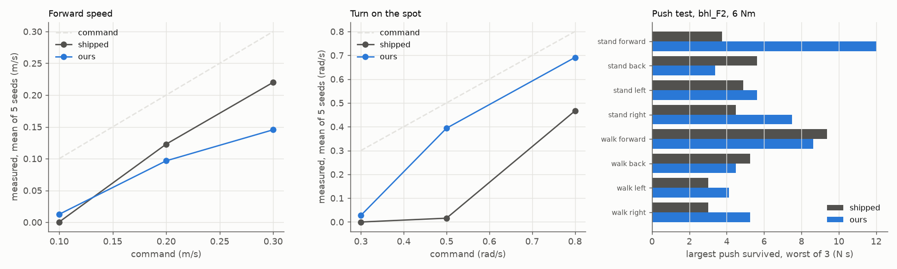
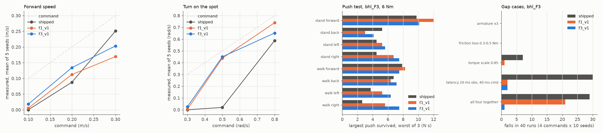

# Walking policy: training and evaluation

This folder trains walking policies for the Berkeley Humanoid Lite (BHL) legs of our robot.
Training uses reinforcement learning with Brax PPO on MuJoCo MJX (JAX, GPU).
PPO (Proximal Policy Optimization) is the usual learning method for legged robots.
The evaluation compares policies with the shipped BHL policy in CPU MuJoCo, on the final design F2 or on the trolley version F3.

**Status:** built and tested in simulation. Nothing here is measured on laptop or measured on board.

## Policies

| File | What it is |
|---|---|
| `sim/sim2sim/policy_biped_25hz_a.onnx` | The shipped BHL policy (MIT licence) |
| `policies/f1_v1.onnx` | Our policy for F1 and F2, fine-tuned from the shipped weights |
| `policies/f1_v1.json` | Card of f1_v1: interface, training stages and settings |
| `policies/f3_v1.onnx` | Our policy for the trolley version F3, fine-tuned from f1_v1 with wide ranges for the real robot |
| `policies/f3_v1.json` | Card of f3_v1: interface, training stages, ranges and results |

All three files have the same interface: 45 inputs, 12 outputs, joint target = default + 0.25 × action, 25 Hz.
So f1_v1 and f3_v1 are drop-in files for `legs/run_policy.py` and `sim/sim2sim/run.py`.
f1_v1 was trained on the earlier F1 model (15.24 kg). We evaluate it on F2 (15.99 kg with full tanks).
f3_v1 was trained on the F3 model of 29 October (14.58 kg). The section [F3](#f3-the-trolley-version-and-the-policy-f3_v1) describes it.

## Setup (once)

1. Fetch the BHL meshes and URDF (from the repository root):
   ```
   scripts/fetch_bhl_assets.sh
   ```
2. Build the MuJoCo models of the robot. This writes `sim/payload/models/bhl_F2*.xml` and `bhl_F3*.xml`:
   ```
   uv run python sim/payload/models.py
   ```
3. Install the training environment. It needs Linux and an NVIDIA GPU:
   ```
   cd sim/rl && uv sync
   ```
4. Run the CPU self-check of the training task (about 2 min):
   ```
   cd sim/rl && JAX_PLATFORMS=cpu uv run python f1_env.py
   ```
   It prints `check passed: bhl_F2.xml, model mass 15.99 kg, observation matches run.py ...`.
   With `FF_DESIGN=F3` in front of the command, it checks `bhl_F3.xml` and prints 14.60 kg.

`sim/rl/pyproject.toml` keeps JAX below 0.9, because newer JAX removes functions that Brax 0.14 needs.
The evaluation runs in the root environment, on the CPU. It does not need JAX.

## Train

The training task is `f1_env.py`. It copies the BHL Isaac Lab task: the 45 inputs, the rewards and the 0.78 rad fall limit.
It adds our robot and hardware:

- the model `bhl_F2.xml`, with the water from empty to full
- payload masses × 0.8 to 1.2, and the payload centre of mass ± 3 cm
- knee range 0 to 1.4 rad (the foot touches a tank at full knee range)
- torque limit 6 to 9 Nm, command and observation latency 0 to 20 ms, joint zero error ± 0.05 rad
- a recoil force of up to 1.5 N at the nozzle, and a constant force and torque on the torso
- a command mix of stand, turn on the spot and slow walking, with a new command every 3 to 8 s

The section F3 below lists the newer settings of f3_v1. Their defaults keep the task of f1_v1.

Run the two stages of f1_v1 from `sim/rl/`. `XLA_PYTHON_CLIENT_MEM_FRACTION` limits the GPU memory of JAX, so other jobs can share the GPU.

1. Stage 1: start from the shipped weights, 9 Nm, mild randomisation, no pushes (121 M steps, 36 min on a shared RTX 3090):
   ```
   XLA_PYTHON_CLIENT_MEM_FRACTION=0.45 uv run python train_f1.py runs/f1_d 120e6 --evals=12 --warm=../sim2sim/policy_biped_25hz_a.onnx --std=0.2 --lr=1e-4 --kl=0.005 --entropy=0.002 "--set=torque_range=[9.0,9.0]" "--set=act_delay_steps=2" "--set=obs_delay_steps=2" "--set=push.enable=False" "--set=reset_wrench=[0.5,0.5]" "--set=zero_offset=0.03" "--set=cmd_mix=[0.15,0.3,0.35,0.2]" "--set=reward.no_step=-2.0"
   ```
2. Stage 2: 6 to 9 Nm, full latency and zero error, no pushes (101 M steps, 34 min):
   ```
   XLA_PYTHON_CLIENT_MEM_FRACTION=0.45 uv run python train_f1.py runs/f1_e 100e6 --evals=10 --restore=runs/f1_d/params_latest.pkl --lr=1e-4 --kl=0.005 --entropy=0.002 "--set=cmd_mix=[0.15,0.25,0.4,0.2]" "--set=push.enable=False" "--set=reward.no_step=-2.0" "--set=reward.stand_feet_air=-1.0" "--set=tracking_std=0.15"
   ```
3. Export the ONNX file to `runs/f1_e/policy.onnx`. The script checks the ONNX output against the JAX policy:
   ```
   JAX_PLATFORMS=cpu uv run python export_onnx.py runs/f1_e
   ```

Each run writes `config.json`, `progress.jsonl` and `params_<step>.pkl` into its folder. The `runs/` folder stays local (git-ignored).
`--set=<key>=<value>` changes one setting of `default_config()` in `f1_env.py`.
`config.json` also stores the model file of the run.

To run an ONNX policy inside the training simulator, with one randomisation term at a time (GPU):
```
cd sim/rl && XLA_PYTHON_CLIENT_MEM_FRACTION=0.3 uv run python mjx_check.py ../sim2sim/policy_biped_25hz_a.onnx 6 --terms
```

## Evaluate

Run these commands from the repository root:

| What | Command | Time | Output |
|---|---|---|---|
| Help | `uv run python sim/rl/f1_eval.py --help` | 1 s | - |
| Short check of one policy, 2 seeds | `uv run python sim/rl/f1_eval.py sim/rl/policies/f1_v1.onnx --quick` | 15 s | screen only |
| Full comparison with the shipped policy on F2, 6 Nm | `uv run python sim/rl/f1_eval.py sim/rl/policies/f1_v1.onnx` | 20 to 30 min | `results/f2_eval_f1_v1.*` |
| The same at 9 Nm | `uv run python sim/rl/f1_eval.py sim/rl/policies/f1_v1.onnx --limit=9` | 20 to 30 min | `results/f2_eval_f1_v1_9nm.*` |
| Full comparison on F3: shipped, f1_v1 and f3_v1 | `uv run python sim/rl/f1_eval.py sim/rl/policies/f3_v1.onnx --model=F3 --compare=sim/rl/policies/f1_v1.onnx` | about 32 min | `results/f3_eval_f3_v1.*` |
| Three videos | `MUJOCO_GL=egl uv run python sim/rl/f1_eval.py sim/rl/policies/f1_v1.onnx --video` | - | `results/*.mp4` (local) |

The loop is the one of `sim/sim2sim/run.py`: 25 Hz policy, 2 kHz physics, PD 20 / 2, training noise, BHL start drop.
It adds the joint target clip of `legs/robot.py` (knee ≤ 1.4 rad), a moving pan-tilt and a recoil force at the nozzle.
The push test uses `sim/payload/torso_tank.py`. The drive cases use `sim/sim2sim/hw_risks.py` (cases 1, 7 and 7b).

- `--model=F3` evaluates on `bhl_F3.xml`. The default is F2, so the F2 results below stay valid.
  On F2, the light-model tests use the empty tanks. On F3, they use `bhl_F3_1pack.xml` and `bhl_F3_tether.xml`.
- `--compare=<onnx>` adds one more policy to the tables and the figure.
- The gap cases run the `hw_risks.py` loop with a changed plant and drive: armature × 3, joint friction 0.3 to 0.5 Nm,
  K, D and the torque limit × 0.85, and 20 ms observation plus 40 ms command latency. They run one at a time and all together.
- The F2 results below come from the script before the gap cases. A new F2 run adds the gap cases to the tables.

## Results on F2

Status: tested in simulation. Model `bhl_F2.xml`, 15.99 kg (15.21 kg with empty tanks).
Full tables: [results/f2_eval_f1_v1.md](results/f2_eval_f1_v1.md) (6 Nm) and [results/f2_eval_f1_v1_9nm.md](results/f2_eval_f1_v1_9nm.md) (9 Nm).
The push test and the drive cases keep their own limits, so they are only in the 6 Nm columns.

| Result | Shipped, 6 Nm | Shipped, 9 Nm | f1_v1, 6 Nm | f1_v1, 9 Nm |
|---|---|---|---|---|
| Falls, 65 command runs | 6 | 0 | 0 | 0 |
| Falls, 64 start-from-a-stand runs | 23 | 0 | 0 | 0 |
| Falls, 120 drive-model runs | 9 | - | 0 | - |
| Speed at a 0.3 m/s command (m/s) | 0.22 | 0.28 | 0.15 | 0.19 |
| Yaw rate, turn on the spot at 0.5 rad/s (rad/s) | 0.02 | 0.01 | 0.39 | 0.41 |
| Smallest push survived while standing (N s) | 3.8 (forward) | - | 3.4 (back) | - |
| Highest knee angle at a 0.3 m/s command (rad) | 1.56 | 1.36 | 1.17 | 1.12 |



1. f1_v1 does not fall in the command, start and drive tests. The shipped policy falls in 6 of 65 command runs at 6 Nm.
2. f1_v1 turns on the spot at a 0.5 rad/s command (0.39 rad/s). The shipped policy does not (0.02 rad/s).
3. f1_v1 walks more slowly: 0.15 m/s at a 0.3 m/s command, against 0.22 m/s.
4. At 9 Nm, neither policy falls. The shipped policy then walks at 0.28 m/s.
5. f1_v1 is weaker against a backward push while standing (3.4 against 5.6 N s). It is stronger against a forward push (12.0 against 3.8 N s).
6. f1_v1 keeps the knee below 1.4 rad. The runtime clips the knee target of the shipped policy.
7. At 0.10 m/s, neither policy walks. Command at least 0.2 m/s.

## F3: the trolley version and the policy f3_v1

On 29 October 2026 the team chose the trolley version F3. A teammate pushes a trolley behind the robot.
The water tank and the pump hang high on the trolley. Only the hose comes down to the robot.
The two pan-tilt servos aim the nozzle.

| Model | Mass (kg) | Centre of mass above the floor (m) |
|---|---|---|
| `bhl_F2.xml`, full tanks (the old design) | 15.99 | 0.449 |
| `bhl_F3.xml`, trolley version | 14.60 | 0.432 |
| `bhl_F3_1pack.xml`, one 6S pack | 14.00 | 0.425 |
| `bhl_F3_tether.xml`, no 6S pack, motor power by cable | 13.46 | 0.418 |

The training and the results below used the F3 model of 29 October: 14.58 kg, centre of mass 0.431 m.
Since then, `models.py` reads the F3 CAD layout. The difference is 21 g, and the centre of mass moved 0.3 mm back.

Previous course years never made the BHL walk. So f3_v1 trains with wide ranges for the robot values that we do not know well.
The team will weigh every printed part and motor. Then the model will match the real robot better.

**Status:** f3_v1 is built and tested in simulation. It is not measured on laptop or measured on board.

### New settings of the training task

`f1_env.py` has new settings. Their defaults keep the f1_v1 task, so the f1_v1 commands above still give the same task.
A CPU test showed the same randomisation and the same first 30 steps as the code before the change.
`FF_DESIGN=F3` makes `f1_env.py` load `bhl_F3.xml`. F3 has no water body, so the water term is off.

| Setting (`--set=` key) | Default (f1_v1 task) | Stage A (mild) | Stages B and C (full) | Stage E (last) |
|---|---|---|---|---|
| `torque_range` (Nm) | 6 to 9 | 6 | 6 | 6 |
| `torque_scale`, one value per motor type | 1 | 0.95 to 1.05 | 0.85 to 1.15 | 0.8 to 1.2 |
| `armature.hip_knee` (kg m²) | 0.004 to 0.008 | 0.005 to 0.015 | 0.007 to 0.025 | 0.007 to 0.025 |
| `armature.ankle` (kg m²) | 0.004 to 0.008 | 0.003 to 0.006 | 0.002 to 0.009 | 0.002 to 0.009 |
| `frictionloss` (Nm) | 0.05 to 0.15 | 0.05 to 0.3 | 0.05 to 0.5 | 0.05 to 0.5 |
| `act_delay_steps`: command latency | 0 to 20 ms | 0 to 20 ms | 0 to 40 ms | 0 to 40 ms |
| `obs_delay_steps`: observation latency | 0 to 20 ms | 0 to 10 ms | 0 to 20 ms | 0 to 20 ms |
| `payload_mass` | × 0.8 to 1.2 | × 0.9 to 1.1 | × 0.85 to 1.15 | × 0.85 to 1.15 |
| `leg_mass`, each leg link | × 1 | × 0.95 to 1.05 | × 0.9 to 1.1 | × 0.9 to 1.1 |
| `imu_tilt` (rad), roll and pitch | 0 | ± 0.026 (1.5°) | ± 0.052 (3°) | ± 0.087 (5°) |
| `hose.base` (N), constant backward pull | 0 | 0 | 0 | 0 to 2.5 |
| `hose.force` (N), changing pull | 0 | 0 to 1.5 | 0 to 3 | 0 to 1.5 |
| `push` | 0.1 to 0.5 m/s every 6 to 12 s | off | off (B), 0.1 to 0.35 m/s every 5 to 10 s (C) | as C |
| `reset_wrench` (N, Nm) | ± 1 | ± 0.5 | ± 1 | ± 1 |

- `torque_scale` is the error of the torque per amp. The drive turns K, D and the torque limit into a current. So one error scales all three.
  The 6512 motors (hip and knee) and the 5010 motors (ankle) get separate values.
- The changing hose pull moves toward a new goal every 1 to 4 s, with a time constant of 1 s. The goal points backward ± 57°.
- The IMU tilt is a fixed roll and pitch per episode. It turns the gravity and gyro inputs. The fall check uses the true torso.
- The leg mass factor scales the mass and the inertia of each of the 12 leg links.
- These values stay as in f1_v1:
  - foot friction 0.4 to 1.2, and the torso and payload centre of mass ± 3 cm
  - kp and kd × 0.8 to 1.2 for each joint (BHL), on top of `torque_scale`
  - joint zero error ± 0.05 rad, knee limit 1.4 rad, and a recoil of 0 to 1.5 N at the nozzle
- All stages use the rewards and commands of f1_v1 stage 2. These are `no_step` −2, `stand_feet_air` −1, `tracking_std` 0.15 and the command mix 0.15 / 0.25 / 0.4 / 0.2.

### Training stages of f3_v1

Status: built and tested in simulation. GPU: the local RTX 3090, shared with CPU simulation jobs.

| Stage | Run | Starts from | What changes | Env steps | Time (min) |
|---|---|---|---|---|---|
| A | `f3_a` | the weights of `policies/f1_v1.onnx`, a new critic, action noise 0.2 | mild ranges, no pushes | 60.6 M | 9.3 |
| B | `f3_b` | `f3_a` | full ranges, no pushes | 201.7 M | 37.2 |
| C | `f3_c` | `f3_b` | full ranges and moderate pushes | 100.5 M | 19.6 |
| E | `f3_e` = f3_v1 | `f3_c` | torque scale 0.8 to 1.2, IMU tilt ± 5°, constant hose part | 81.2 M | 13.6 |

f3_v1 used 444 M steps and 80 min of GPU time. All runs together used about 160 min.
These runs did not go into f3_v1:

- The first try of stage A stopped at the first evaluation. `train_f1.py` read the f1_v1 weights in the wrong layout. We fixed the warm start.
- Stage D (`f3_d`, from `f3_c`, 60.9 M steps, 11.9 min) raised the speed reward from 2 to 3. It did not walk faster: 0.191 against 0.200 m/s at a 0.3 m/s command. We did not use it.
- The comparison runs `f3s_a`, `f3s_b` and `f3s_c` start from the shipped weights. They use the settings of stages A, B and C.

Run the stages from `sim/rl/`:

1. Stage A: mild ranges, no pushes (60.6 M steps, 9 min):
   ```
   FF_DESIGN=F3 XLA_PYTHON_CLIENT_MEM_FRACTION=0.45 uv run python train_f1.py runs/f3_a 60e6 --evals=8 --warm=policies/f1_v1.onnx --std=0.2 --lr=1e-4 --kl=0.005 --entropy=0.002 "--set=torque_range=[6.0,6.0]" "--set=torque_scale=[0.95,1.05]" "--set=armature.hip_knee=[0.005,0.015]" "--set=armature.ankle=[0.003,0.006]" "--set=frictionloss=[0.05,0.3]" "--set=act_delay_steps=4" "--set=obs_delay_steps=2" "--set=payload_mass=[0.9,1.1]" "--set=leg_mass=[0.95,1.05]" "--set=imu_tilt=0.026" "--set=hose.force=[0.0,1.5]" "--set=push.enable=False" "--set=reset_wrench=[0.5,0.5]" "--set=cmd_mix=[0.15,0.25,0.4,0.2]" "--set=reward.no_step=-2.0" "--set=reward.stand_feet_air=-1.0" "--set=tracking_std=0.15"
   ```
2. Stage B: full ranges, no pushes (201.7 M steps, 37 min):
   ```
   FF_DESIGN=F3 XLA_PYTHON_CLIENT_MEM_FRACTION=0.45 uv run python train_f1.py runs/f3_b 200e6 --evals=10 --restore=runs/f3_a/params_latest.pkl --lr=1e-4 --kl=0.005 --entropy=0.002 "--set=torque_range=[6.0,6.0]" "--set=torque_scale=[0.85,1.15]" "--set=armature.hip_knee=[0.007,0.025]" "--set=armature.ankle=[0.002,0.009]" "--set=frictionloss=[0.05,0.5]" "--set=act_delay_steps=8" "--set=obs_delay_steps=4" "--set=payload_mass=[0.85,1.15]" "--set=leg_mass=[0.9,1.1]" "--set=imu_tilt=0.052" "--set=hose.force=[0.0,3.0]" "--set=push.enable=False" "--set=cmd_mix=[0.15,0.25,0.4,0.2]" "--set=reward.no_step=-2.0" "--set=reward.stand_feet_air=-1.0" "--set=tracking_std=0.15"
   ```
3. Stage C: full ranges and moderate pushes (100.5 M steps, 20 min):
   ```
   FF_DESIGN=F3 XLA_PYTHON_CLIENT_MEM_FRACTION=0.45 uv run python train_f1.py runs/f3_c 100e6 --evals=8 --restore=runs/f3_b/params_latest.pkl --lr=1e-4 --kl=0.005 --entropy=0.002 "--set=torque_range=[6.0,6.0]" "--set=torque_scale=[0.85,1.15]" "--set=armature.hip_knee=[0.007,0.025]" "--set=armature.ankle=[0.002,0.009]" "--set=frictionloss=[0.05,0.5]" "--set=act_delay_steps=8" "--set=obs_delay_steps=4" "--set=payload_mass=[0.85,1.15]" "--set=leg_mass=[0.9,1.1]" "--set=imu_tilt=0.052" "--set=hose.force=[0.0,3.0]" "--set=push.enable=True" "--set=push.magnitude=[0.1,0.35]" "--set=push.interval=[5.0,10.0]" "--set=cmd_mix=[0.15,0.25,0.4,0.2]" "--set=reward.no_step=-2.0" "--set=reward.stand_feet_air=-1.0" "--set=tracking_std=0.15"
   ```
4. Stage E: the wider ranges of the gap study (81.2 M steps, 14 min):
   ```
   FF_DESIGN=F3 XLA_PYTHON_CLIENT_MEM_FRACTION=0.45 uv run python train_f1.py runs/f3_e 80e6 --evals=8 --restore=runs/f3_c/params_latest.pkl --lr=1e-4 --kl=0.005 --entropy=0.002 "--set=torque_range=[6.0,6.0]" "--set=torque_scale=[0.8,1.2]" "--set=armature.hip_knee=[0.007,0.025]" "--set=armature.ankle=[0.002,0.009]" "--set=frictionloss=[0.05,0.5]" "--set=act_delay_steps=8" "--set=obs_delay_steps=4" "--set=payload_mass=[0.85,1.15]" "--set=leg_mass=[0.9,1.1]" "--set=imu_tilt=0.087" "--set=hose.base=[0.0,2.5]" "--set=hose.force=[0.0,1.5]" "--set=push.enable=True" "--set=push.magnitude=[0.1,0.35]" "--set=push.interval=[5.0,10.0]" "--set=cmd_mix=[0.15,0.25,0.4,0.2]" "--set=reward.no_step=-2.0" "--set=reward.stand_feet_air=-1.0" "--set=tracking_std=0.15"
   ```
5. Export f3_v1. The script checks the ONNX output against the JAX policy:
   ```
   JAX_PLATFORMS=cpu uv run python export_onnx.py runs/f3_e runs/f3_e/params_latest.pkl policies/f3_v1.onnx
   ```

- **Not verified:** a new run of these commands gives a similar policy, but not the same numbers. The GPU simulation is not bit-exact.
- The evaluation length in the training log stays near 160 to 260 of 500 steps. Most of these falls come in the first second after the BHL reset.
  The reset gives the robot random joint angles (× 0.5 to 1.5) and a random speed of up to 0.5 m/s. A CPU test of f1_v1 showed the same pattern.

### How we chose f3_v1

We checked each stage on the CPU (`bhl_F3.xml`, 6 Nm, 5 seeds for the speeds, 40 runs for each gap case).
The gap cases are the cases of `f1_eval.py`. R+hose and R+imu are cases of `sim/sim2sim/gap_study.py`.

| Policy | vx at a 0.3 m/s command (m/s) | Turn on the spot at 0.5 rad/s (rad/s) | Gap case "all four together": falls | R+hose: falls | R+imu: falls |
|---|---|---|---|---|---|
| shipped | 0.25 | 0.03 | 29 of 40 | 10 of 20 | 17 of 20 |
| f1_v1 | 0.17 | 0.44 | 21 of 40 | 15 of 20 | 5 of 20 |
| f3_a (stage A) | 0.21 | 0.43 | 5 of 40 | - | - |
| f3_b (stage B) | 0.19 | 0.45 | 1 of 40 | - | - |
| f3_c (stage C) | 0.20 | 0.45 | 0 of 40 | 4 of 40 | 1 of 40 |
| f3_d (stage D, not used) | 0.19 | 0.40 | - | - | - |
| f3_e (stage E) = f3_v1 | 0.20 | 0.45 | 1 of 40 | 0 of 40 | 0 of 40 |

- The shipped and f1_v1 values of R+hose and R+imu come from `gap_study.md`. That study runs only the two walking commands in its R+ cases (20 runs).
- Stage C and stage E are equally good in the other cases. Each has 0 to 2 falls in 40 runs, which is noise.
- We chose stage E. It was trained on the wider ranges, and it does not fall with a constant 3 N hose pull.

### Results on F3

Status: tested in simulation. Model `bhl_F3.xml` of 29 October (14.58 kg), 6 Nm torque limit.
Full tables: [results/f3_eval_f3_v1.md](results/f3_eval_f3_v1.md). Run time: 32 min with 3 processes on a shared computer.

| Result | Shipped | f1_v1 | f3_v1 |
|---|---|---|---|
| Falls, 75 command runs (F3 and its two lighter options) | 0 | 0 | 0 |
| Falls, 64 start-from-a-stand runs | 0 | 0 | 0 |
| Started to walk, 64 start-from-a-stand runs | 17 | 25 | 38 |
| Falls, 120 drive-model runs (`hw_risks.py` cases 1, 7, 7b) | 6 | 0 | 0 |
| Falls, 200 gap-case runs | 66 | 24 | 3 |
| Speed at a 0.3 m/s command (m/s) | 0.25 | 0.17 | 0.20 |
| Yaw rate, turn on the spot at 0.5 rad/s (rad/s) | 0.02 | 0.44 | 0.45 |
| Standing: steps per second, drift in 15 s (m) | 0, 0.01 | 0, 0.01 | 0, 0.01 |
| Smallest push survived while standing (N s) | 4.5 (left) | 3.0 (back) | 4.1 (back) |
| Highest knee angle at a 0.3 m/s command (rad) | 1.36 | 1.16 | 0.84 |

Falls in the gap cases of `f1_eval.py` (40 runs each: 4 commands × 10 seeds):

| Gap case | Shipped | f1_v1 | f3_v1 |
|---|---|---|---|
| Armature × 3 (0.015 kg m² on all leg joints) | 0 | 0 | 0 |
| Joint friction 0.3 to 0.5 Nm | 0 | 0 | 0 |
| K, D and torque limit × 0.85 | 7 | 1 | 0 |
| Latency: 20 ms observation and 40 ms command | 30 | 2 | 2 |
| All four together | 29 | 21 | 1 |



The targets of the F3 training:

| Target (CPU evaluation, F3, 6 Nm) | Result | Met |
|---|---|---|
| No falls in the command runs and the start-from-a-stand runs | 0 of 75 and 0 of 64 | yes |
| At least 0.2 m/s at a 0.3 m/s command | 0.203 m/s, mean of 5 seeds | yes, by a small margin |
| At least 0.3 rad/s at a 0.5 rad/s turn on the spot | 0.45 rad/s | yes |
| Quiet standing | 0 steps, no foot in the air, 0.01 m drift in 15 s | yes |
| Fewer falls than shipped and f1_v1 with the gap terms | all four together: 1 against 29 and 21 | yes |

1. f3_v1 does not fall in the command, start and drive-model runs.
2. With all four gap terms together, f3_v1 falls in 1 of 40 runs. f1_v1 falls in 21 and the shipped policy in 29.
3. In three single gap cases, f3_v1 only ties f1_v1. Both have 0 falls with armature × 3 and with joint friction, and 2 falls with the latency case.
4. f3_v1 walks faster than f1_v1 (0.20 against 0.17 m/s). The shipped policy is still faster (0.25 m/s).
5. f3_v1 starts to walk from a stand in more runs than both other policies. At 0.10 m/s, no policy walks. Command at least 0.2 m/s.
6. f3_v1 takes more steps: 4.4 per second at 0.3 m/s, against 3.6 (f1_v1) and 3.1 (shipped).
7. f3_v1 survives larger side pushes while it walks at 0.3 m/s: 6.4 N s to the left and 7.5 N s to the right. The shipped policy survives 3.8 and 2.6 N s.

### Gap study of the trolley version (`sim/sim2sim/gap_study.py`)

`uv run python sim/sim2sim/gap_study.py --policy sim/rl/policies/f3_v1.onnx` adds f3_v1 to `sim/sim2sim/results/gap_study.md`.
It took 35 min with 6 processes. R is the realistic case. P is the pessimistic case. R+ is R with one value moved to its value in P.

| Cases (runs per policy) | Shipped | f1_v1 | f3_v1 |
|---|---|---|---|
| Five models: bare biped, F2, F3, F3 one pack, F3 by cable (200) | 2 | 0 | 0 |
| One change at a time on F3, 25 cases (1000) | 31 | 11 | 0 |
| R (40) | 5 | 0 | 0 |
| R+, 12 cases (240) | 123 | 53 | 1 |
| P (40) | 40 | 40 | 40 |
| R at 9 Nm (40) | 1 | 0 | 0 |
| P at 9 Nm, 7.65 Nm at the joint (40) | 40 | 37 | 26 |

The R+ cases run only the two walking commands, 10 seeds each (falls of 20):

| R with | Shipped | f1_v1 | f3_v1 |
|---|---|---|---|
| torso CoM 2 cm back | 14 | 12 | 1 |
| torque per amp × 0.85 | 14 | 13 | 0 |
| hose pull 3 N, constant | 10 | 15 | 0 |
| command latency 40 ms | 19 | 3 | 0 |
| IMU tilt 4° | 17 | 5 | 0 |
| observation latency 20 ms | 11 | 2 | 0 |
| joint zero error ± 2° | 9 | 0 | 0 |
| armature 0.0224 / 0.0074 kg m² | 7 | 1 | 0 |
| foot friction 0.4 | 6 | 1 | 0 |
| joint friction 0.5 Nm | 6 | 0 | 0 |
| legs + 10 % | 6 | 0 | 0 |
| gear play 1° | 4 | 1 | 0 |

- In R, f3_v1 walks at 0.18 m/s at a 0.3 m/s command. The shipped policy walks at 0.22 m/s and f1_v1 at 0.15 m/s.
- P still makes all 40 runs of each policy fall. P has every value at its worst at the same time, and gear play, which is not in the training.
- A one-off check with the stage B policy removed one P value at a time. No single removal stopped the falls.
  Without the hose pull, 3 of 5 standing runs did not fall.

### Start from f1_v1 or from the shipped weights

The comparison runs `f3s_a`, `f3s_b` and `f3s_c` start from the shipped weights. They use the commands of stages A, B and C.
The table compares them after stage C with the same checks.

| After stage C | From f1_v1 (`f3_c`) | From the shipped weights (`f3s_c`) |
|---|---|---|
| Training reward at the end of stage A | 3.6 | 1.6 |
| Speed at a 0.3 m/s command (m/s) | 0.20 | 0.18 |
| Turn on the spot at 0.5 rad/s (rad/s) | 0.45 | 0.42 |
| Gap case "all four together": falls of 40 | 0 | 6 |
| R, R+com, R+torque, R+hose, R+cmd, R+imu: falls of 40 each (4 commands) | 0, 0, 0, 4, 0, 1 | 0, 1, 0, 4, 0, 3 |

The start from f1_v1 is better. After the same stages, it walks faster and falls less.

## Files

| File | What it does |
|---|---|
| `f1_env.py` | Training task for MJX. Run it for the CPU self-check. |
| `train_f1.py` | PPO training. `--warm=<onnx>` starts from ONNX weights, `--restore=<pkl>` from a checkpoint. |
| `export_onnx.py` | Writes `policy.onnx` of a run, in the form of the BHL file, and checks it. |
| `f1_eval.py` | CPU comparison with the shipped policy: commands, start from a stand, pushes, drive cases, gap cases, videos. `--model=F3` for F3. |
| `mjx_check.py` | Runs an ONNX policy inside the MJX training simulator. |
| `policies/` | f1_v1, f3_v1 and their cards |
| `results/` | F2 and F3 evaluation tables and figures |
| `pyproject.toml`, `uv.lock` | The training environment (JAX, Brax, MuJoCo MJX, MuJoCo Playground) |

## Open points

- **Not verified:** f1_v1 and f3_v1 have not run on a laptop or on the robot. Test f3_v1 on the gantry first, at 6 Nm with `--knee-max 1.4`.
- **Open:** f1_v1 was trained on F1, not on F2. A new training run uses `bhl_F2.xml` by default.
- **Open:** f1_v1 walks at only 0.15 to 0.19 m/s at a 0.3 m/s command.
- **Open:** f1_v1 is weak against a backward push while standing.
- **Open:** no policy turns on the spot at 0.3 rad/s.
- **Open:** on the fake drives of `legs/` (bare biped), no policy starts to walk from a quiet stand at 0.25 or 0.3 m/s.
  In the CPU evaluation, the same policies start, because the start drop leaves the legs in an uneven stance.
  A start command of 0.45 m/s for 0.5 s fixes it on the fake drives. `actuators/walk_bridge.py` sends it (`robot/config.toml`, `[walk]`).
- **Not verified:** the MJX and CPU models have no motor dynamics, no CAN jitter and a flat floor only.
- **Open:** on the fake drives of `legs/` (`legs_fake_check.py`, bare biped), f3_v1 loads and runs through `legs/run_policy.py`.
  It walks 3.0 m in 12 s at 0.25 m/s and turns at 0.76 rad/s at a 0.8 rad/s command.
  Like the other two policies, it does not start from a quiet stand there, and it turns only 0.07 rad in 12 s at 0.5 rad/s.
  After the start command, it walks 2.2 m in 9 s at 0.25 m/s and turns on the spot at 0.5 rad/s.
- **Open:** f3_v1 walks at 0.20 m/s at a 0.3 m/s command, just at the target. Stage D, with a higher speed reward, did not help.
- **Open:** the pessimistic case P of the gap study still makes f3_v1 fall in all 40 runs. At 9 Nm, 26 of 40 runs fall.
- **Not verified:** the training has no gear play, no motor speed limit and no motor dynamics. The hose pull in the training is horizontal only.
- **Assumed:** the training ranges of the armature, the joint friction, the torque per amp, the IMU tilt and the hose pull.
  Status of their measurement: planned, in the order of `sim/sim2sim/results/gap_study.md`. Retrain with the measured values.
- **Open:** the BHL reset makes about half of the training episodes fall in the first second. A gentler reset could make training faster. This is not tested.

## Licence

Code: MIT (root `LICENSE` file). `policies/f1_v1.onnx` is fine-tuned from the BHL weights `policy_biped_25hz_a.onnx`,
which are MIT (`sim/sim2sim/BHL_LICENCE`). `policies/f3_v1.onnx` is fine-tuned from f1_v1, so the same applies.
The training task follows the BHL Isaac Lab task config (MIT).
