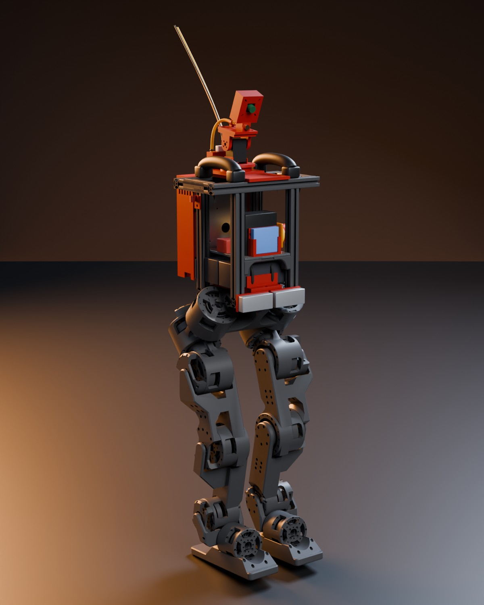
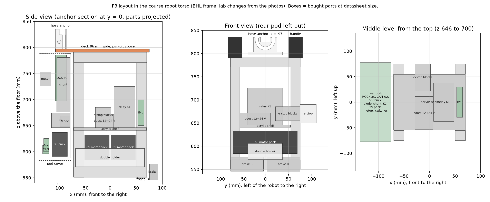
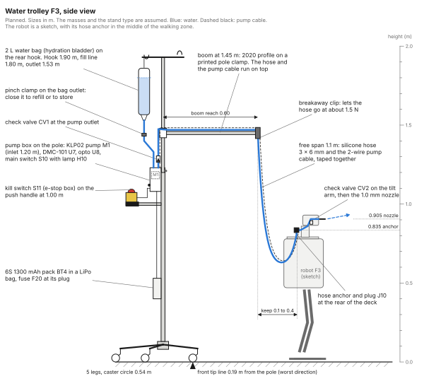

# Design F3: the robot and its water trolley

  

Sobang-I is the course Berkeley Humanoid Lite biped with a fire camera and a nozzle on a pan-tilt on top of the torso. A teammate pushes a trolley behind the robot, like a hospital IV stand. The trolley carries the water bag, the pump and the pump battery. Only the hose and a thin pump cable come down from the trolley to the robot.

The team chose this design on 2026-10-29. It takes 1.4 kg off the robot, because walking on the real robot is our main risk ([walking plan](plan/walking.md)).

Status: the CAD and the print kit are **built**. Walking, aiming and the water jet are **tested in simulation**. Nothing is printed, built or measured yet.

| Item | Value | Details |
|---|---|---|
| Mass | 14.60 kg (bare biped 11.34 kg, old design F2 with full tanks 15.99 kg) | [cad/final](../cad/final/README.md) |
| Legs | 12 cycloidal actuators on XDrive MINI drives, 2 CAN buses | [legs](../legs/README.md) |
| Computer | Radxa ROCK 3C (RK3566, NPU) | [robot](../robot/README.md) |
| Batteries on the robot | 2 × 6S 5000 mAh (motors), 1 × 3S 6000 mAh (computer, relays, servos) | [electrical.md](hardware/electrical.md) |
| Water trolley | IV stand: 2 L bag at 1.90 m, Kamoer KLP02 24 V pump with a DMC-101 controller, its own 6S 1300 mAh pack, a kill switch at the push handle | [trolley.md](hardware/trolley.md) |
| Hose | silicone 3 × 6 mm, 3.0 m, from a boom at 1.45 m to an anchor at the rear of the deck. A breakaway clip lets go at about 1.5 N. | [trolley.md](hardware/trolley.md) |
| Jet | 1.0 mm nozzle, 0.41 L/min, 9.6 m/s. Range at +15°: 5.1 m best estimate, 2.7 m low estimate. 4.8 min of spray per bag. | [water.md](hardware/water.md) |
| Aiming | pan-tilt with two ST3215 servos, nozzle 0.9 m above the floor | [aim](../aim/README.md) |
| Camera | Arducam B0201, 640 × 480, about 97° horizontal view | [vision](../vision/README.md) |
| Fire detector | YOLO11n, 416 × 320, ONNX on the CPU or RKNN INT8 on the NPU | [vision](../vision/README.md) |
| Safety | The robot e-stop cuts the drives, the servos and the pump signal. The trolley kill switch cuts the pump. Software knee limit 1.4 rad. | [electrical.md](hardware/electrical.md) |

## Where the parts are

| Level | Parts |
|---|---|
| Top of the torso | deck, pan-tilt, head with the camera and the nozzle, hose anchor with the plug of the pump cable |
| Middle shelf | main relay K1, boost converter, e-stop contact blocks, IMU |
| Rear pod (outside the frame) | ROCK 3C, OR diode, shunt, relay K2, 3S pack, CAN adapters, 5 V buck, meters and switches |
| Bottom | the two 6S packs, the brake resistors on the front rail |

The print kit has 26 printed pieces (about 0.77 kg of PETG and 45 h of printing) and a 74-step assembly guide: [cad/final/kit](../cad/final/kit/README.md). Do not print the F2 tanks.

## Water trolley

The bag hangs above the pump, so gravity fills the pump. Two check valves stop the water when the pump is off. The person who pushes keeps the hose slack and holds the kill switch. The trolley cannot catch a falling robot ([trolley.md](hardware/trolley.md)).

## Open design points

- **Pan-tilt fastening:** the deck holds the 4 M4 nuts of the pan base in pockets that open to the top. So only its weight holds the pan-tilt on the deck. Fix it before you print the deck, for example with M4 heat-set inserts.
- **Deck screws:** the 2 rear deck screws sit under the edge of the pan base. Fix this before you print the deck and the pan base.
- **Pod cover:** hang the cover before you fasten the deck. To open the pod later, take off the pan-tilt and the deck first.
- **Battery places:** our proposal. Check them with the TA.
- **Fourth e-stop contact block:** the pump stop needs a fourth block on the e-stop. Check that 4 blocks fit: the boost converter is 11 mm away.
- **Trolley stand:** a light IV stand tips over at a hose pull of 7 to 11 N. Buy a heavy stand or add ballast.
- **DMC-101:** we still need its datasheet to confirm the pump control input.
- **Hose loop:** check it over the full pan and tilt range before the first spray.
