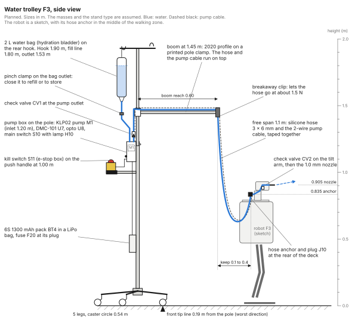

# Water trolley (design F3)

Status: **planned**. The numbers come from `trolley.py` and `sim/water/water.py` (**tested in simulation**). Nothing is built or measured.

The team decided on 2026-10-29 to take the water off the robot. A person pushes a trolley like a hospital IV stand behind the robot. The water bag, the pump and its battery ride on the trolley. Only the hose and a 2-wire pump cable come down from a boom to the robot. The two pan-tilt servos still aim the nozzle. This design F3 replaces the two side tanks R2 of design F2.

- **Assumed:** all sizes and masses in this document. We do not have the stand yet. The light stand type (4 kg) is the worst case for tipping.
- **Assumed:** the hose leaves the anchor at the rear of the deck 0.835 m high, going up. The anchor holds the plug J10. These values come from the F3 CAD in progress (`archive/cad/final/out_f3/kit.json`).
- **Not verified:** the release force of the breakaway clip (1.5 N). Test TT2 sets it.
- **Open:** the DMC-101 datasheet. The pump stop needs a control input that runs the pump only while the opto-isolator conducts ([electrical.md](electrical.md), section 5).
- **Open:** the printed parts (pole clamps, breakaway clip, hose clips, pump box brackets) are not drawn yet.

## 1. Summary

| Item | Choice | Key number |
|---|---|---|
| Stand | IV stand, 5 legs on casters, height adjustable, 2 hooks | caster circle 0.54 m, 4 kg (light type) |
| Water | 2 L hydration bag on the rear hook | 4.8 min of spray per fill |
| Pump box | KLP02 pump, DMC-101, opto-isolator U8, main switch S10 with lamp H10 | pump inlet 0.33 m below the bag outlet |
| Power | 6S 1300 mAh LiPo pack BT4, fuse F20 3 A | 1.6 h of continuous spray (20 fills) |
| Stops | kill switch S11 at the push handle, robot e-stop contact NC4, pulled plug J10, software | section 5 |
| Boom | 2020 aluminium profile, 1.45 m high, reaches 0.60 m toward the robot | |
| Hose | silicone 3 × 6 mm, 3.0 m, free span 1.1 m | 41 g/m with water and cable |
| Jet | 1.0 mm nozzle at 0.905 m | 0.41 L/min, 9.6 m/s, 5.1 m at +15° (best estimate) |
| Hose pull that tips the trolley | worst direction, at the boom tip | 7.0 N (empty bag) to 11.0 N (full bag) |
| Hose force on the robot | | 0.1 N while slack, at most 1.5 N when taut (breakaway clip) |
| Mass | | 7.8 kg full, 5.8 kg empty |
| Cost | | about 220,000 KRW. Many prices are GUESS (section 11). |

## 2. Layout



Figure 1. Side view. Blue: water. Dashed black: pump cable. The robot is a sketch, with its hose anchor in the middle of the walking zone. `trolley.py` draws it.

| Item | Height (m) | Why |
|---|---|---|
| Hook | 1.90 | The bag hangs high, as the team decided. Keep the hook at 2.1 m or lower ([water.md](water.md), section 3.3). |
| Water surface, full bag | 1.80 | |
| Bag outlet | 1.53 | |
| Boom | 1.45 | about 0.5 m above the robot head. The hose comes down to the robot from above. |
| Pump inlet | 1.20 | 0.33 m below the bag outlet: the water fills the pump. |
| Push handle and kill switch | 1.00 | hand height of a standing person |
| Pack BT4 | 0.40 to 0.53 | low on the pole: it lowers the centre of mass |
| Hose anchor on the robot | 0.835 | rear of the deck, hose exit |
| Nozzle | 0.905 | |

- Hang the bag on the rear hook, away from the robot. This moves the mass back and raises the tip force from 9.4 N to 11.0 N (full bag).
- Turn the boom toward the robot. The pump box and the handle face the person who pushes.

## 3. Water bag

We choose a 2 L hydration bag, the type that sits in a running or cycling backpack.

- **Why 2 L:** one fill gives 4.8 min of spray. That is about 10 small fires of 30 s ([water.md](water.md), section 7), with time for test shots. A 1.5 L bag gives 3.6 min. A 3 L bag is taller and heavier.
- **Why a bag:** it collapses as it empties. It needs no air vent, and no air enters the line. The wide top opening makes refills easy. The outlet points down when the bag hangs.
- **Assumed:** the full bag is about 0.33 m tall and hangs 0.04 m below the hook. It holds about 20 mL that the pump cannot take.
- A pinch clamp on the bag hose closes the outlet for refills, transport and storage.
- The 100 mesh inline filter on the bag hose protects the pump and the 1.0 mm nozzle.
- The bag weighs 2.15 kg when full. On the rear hook it makes the trolley more stable (section 9).

## 4. Pump box

- An ABS box of about 150 × 100 × 70 mm sits on the rear of the pole, from 1.08 to 1.23 m.
- It holds the KLP02 pump M1, the DMC-101 U7, the opto-isolator U8 and a Wago 221-413 node for GND_T. The main switch S10 with its lamp H10 sits on the face toward the person who pushes.
- Check valve CV1 sits on the pump outlet, on top of the box, arrow away from the pump.
- The pump inlet is 0.33 m below the bag outlet. The water fills the pump by gravity, also after a refill.
- Mount the DMC-101 and U8 on the box wall above the pump. Then a leaking pump joint cannot drip on them. Drill a 3 mm drain hole in the bottom of the box.
- **Open:** Kamoer does not publish the KLP02 size or port size. Lay out the box when the pump arrives.

## 5. Electrical

The circuit is on drawing SOB-E-01, revision C, zones C5 to E8 ([SOB-E-01_power.svg](schematic/SOB-E-01_power.svg)). The wires are W37, W42, W60 and W70 to W72 in [harness.csv](harness.csv).

1. Pack BT4 → fuse F20 (3 A, at the XT60) → main switch S10 → kill switch S11 → DMC-101 → pump.
2. Lamp H10 lights while the DMC-101 has power.
3. ROCK 3C pin 11 → R7 470 Ω → robot e-stop contact S1 NC4 → plug J10 → cable W60 → LED of U8. U8 switches the DMC-101 on and off.

Why a 6S pack: the old design F2 ran the pump on the 6S motor bus. A 6S pack gives the same 21.0 to 25.2 V, so the pump numbers in [water.md](water.md) stay valid. It runs the pump for 1.6 h of continuous spray, or 20 fills of the bag ([power_calc.md](power_calc.md)). The team already charges 6S packs. It weighs about 200 g.

A LiPo alarm on the balance lead beeps when a cell is low. Unplug it after the session, because it drains the pack slowly.

| Stop | Who | What happens | Type |
|---|---|---|---|
| Kill switch S11 | the person who pushes | cuts the pump power | hardware |
| Robot e-stop S1 | the e-stop person | NC4 opens the LED loop of U8, NC1 opens K1 | hardware |
| Plug J10 pulled out | nobody | the LED loop opens | hardware |
| E-stop sense, pin 13 | `robot/pump.py` | keeps pin 11 low while the e-stop is pressed | software |
| `max_spray_s`, `keepalive_s` | `robot/pump.py` | pump off after 12 s on, or 0.3 s without updates | software |
| Main switch S10 | the person who pushes | cuts all trolley power | hardware |

- **Plug J10:** JST SM 2-pin. It fits the space of about 20 × 12 × 10 mm in the hose anchor. It latches, it is polarised, and pairs with leads cost little. It is not sealed. Water on J10 can short the LED, and then the pump stops.
- **Cable W60:** a twisted pair of 22 AWG wire, 2.2 m, taped to the hose every 0.3 m. It carries 4.5 mA at 3.3 V.
- **No common ground:** the robot (GND_3S) and the trolley (GND_T) share no wire. U8 passes the signal as light.
- When the person releases S11, the pump runs again if the robot still asks for water. Release S11 only when the robot does not spray.

## 6. Boom, hose and cable

- **Boom:** an aluminium 2020 profile, 0.60 m long, on a printed two-part pole clamp with two M5 screws, 1.45 m high.
- The hose and the cable run on top of the boom in three printed clips. At the boom tip they pass through the breakaway clip.
- **Breakaway clip:** a printed C-clip that holds the hose. It carries the free span (0.45 N) and lets the hose go at about 1.5 N. This is about one fifth of the 7.0 N that tips the empty trolley. A higher force would make the robot fall (section 10). When it lets go, the hose drops to the floor and the trolley stays upright.
- **Hose:** silicone tube 3 × 6 mm, as in F2. It is light (41 g/m with water and cable) and very flexible. The barbs, the check valves and the filter all fit 3 mm tube.
- **Length:** the path is 2.2 m: pump to boom 0.25 m, boom 0.65 m, free span 1.1 m, anchor to nozzle 0.24 m (the loop of the F3 CAD). Cut 3.0 m. The extra 0.8 m lets you lengthen the free span.
- **Free span:** 1.1 m from the boom tip to the hose anchor. The hose goes taut when the anchor is 0.91 m ahead of the boom tip. With the anchor 0.1 to 0.4 m ahead, the lowest point of the hose is 0.60 to 0.67 m high. That is above the hips (0.40 to 0.50 m) and behind the robot.
- The hose anchor sends the hose straight up at the rear of the deck. Keep the boom tip behind the robot, so the loop hangs behind the robot and not near the legs.
- **Not verified:** the burst pressure of the silicone tube. With a blocked nozzle the pump can reach about 290 kPa. Test T1 in [water.md](water.md) checks the joints at this pressure.

## 7. How to push and keep the hose slack

1. Before the walk, set the hook at 1.90 m and the boom at 1.45 m. Hang the full bag on the rear hook.
2. Stand behind the trolley. Hold the push handle with one hand, with the thumb next to the kill switch S11.
3. Keep the boom tip 0.1 to 0.4 m behind the hose anchor of the robot. The hose goes taut at 0.91 m.
4. Walk at the speed of the robot, 0.2 to 0.3 m/s. Push at the handle, never at the top of the pole.
5. When the robot turns on the spot, walk around it in a small arc. Keep the boom behind the robot.
6. When the hose goes taut, step forward at once. When the hose catches on anything, press S11.
7. Lift the front casters over cables and door sills. A blocked caster tips the full trolley at about 0.7 m/s. A push of 11 to 17 N at the handle tips it when the front casters are blocked.
8. Do not lean on the trolley. Do not hang anything else on the boom.
9. The trolley cannot catch the robot (section 9.1). The e-stop person and the gantry protect the robot.

## 8. Refill and drain

Refill:

1. Close the pinch clamp on the bag outlet.
2. Lift the bag off the hook and open its top.
3. Fill 2.0 L of clean tap water. Mark the 2.0 L line on the bag once, with a measuring jug.
4. Close the top. Hang the bag on the rear hook. Open the pinch clamp.
5. The check valves keep the pump and the hose full. The next jet starts at once.

Drain at the end of the day:

1. Close the pinch clamp. Lift the bag off the hook, pour the water out of its top and hang it back empty.
2. Hold the nozzle over a bucket. Open the pinch clamp.
3. Run the pump for 10 s with `uv run python robot/pump.py --seconds 10` on the robot (J10 plugged in). Air from the empty bag pushes the water out of the hose.
4. Switch S10 off. Unplug BT4 and the LiPo alarm.
5. Hang the bag open, top down, to dry.
6. Store BT4 in its LiPo bag at storage voltage (3.8 V per cell).

## 9. Tip-over check

The trolley tips about the line between its two front casters. The worst case: two legs point forward at ±36°, and the wheels trail 0.03 m behind their stems. The tip line is then 0.19 m in front of the pole. The worst hose pull acts at the boom tip, toward the robot and 16° down.

| Case | Trolley mass (kg) | Hose pull that tips it (N) |
|---|---|---|
| Light stand (4 kg), full bag | 7.8 | 11.0 |
| Light stand, empty bag | 5.8 | 7.0 |
| Heavy stand (10 kg), full bag | 13.8 | 18.4 |
| Heavy stand, empty bag | 11.8 | 14.4 |

- The breakaway clip (1.5 N) lets go first, with a margin of 4.7 times or more.
- The static check ignores the hand of the person who pushes. That hand adds stability, but do not count on it.
- A blocked caster at speed: the centre of mass of the full trolley is 0.92 m high. A point-mass estimate gives a tip at about 0.7 m/s. The robot walks at 0.2 to 0.3 m/s.

| Part (Assumed) | Mass (kg) | Forward of the pole (m) | Height (m) |
|---|---|---|---|
| Stand, light type | 4.0 | 0 | 0.45 |
| Bag with 2 L of water | 2.15 | −0.12 | 1.67 |
| Pump box | 0.60 | −0.05 | 1.16 |
| Handle and kill switch box | 0.38 | −0.15 | 1.03 |
| 6S pack in a LiPo bag | 0.26 | −0.04 | 0.46 |
| Boom and clamp | 0.36 | 0.30 | 1.45 |
| Hose and cable on the trolley | 0.06 | 0.35 | 1.45 |

### 9.1 The trolley cannot catch a falling robot

- The robot weighs 16.35 kg (160 N): the ASMR robot with the F3 parts. Its centre of mass is 0.49 m high (`sim/payload/final_check.py`, stand pose).
- A line from the anchor needs 17 N to hold the robot at a 10° lean, and 34 N at 20°. The light trolley tips at 7 to 11 N.
- To carry the robot weight at the boom tip, the trolley needs 30 kg of ballast on its base. To stop a fall with a jerk of twice the weight, it needs about 66 kg. The boom, its printed clamp and the hose barbs would break first.
- **Warning:** never use the hose, the cable or the boom as a safety line. Use the gantry in the early tests.

## 10. Hose force on the robot

- The hose weighs 41 g/m with water and cable: silicone 24 g/m, water 8 g/m, cable 10 g/m (Assumed). The free span (1.1 m) weighs 0.45 N.
- While the hose is slack, it pulls the anchor down by about 0.10 N and back by less than 0.04 N. The robot also carries the 0.24 m of hose from the anchor to the nozzle, about 8 g with water.
- When the slack is gone, the pull rises until the breakaway clip lets go at about 1.5 N. The pull points 34° above the horizontal, toward the boom tip. At the anchor height (0.835 m) this gives a backward pitch moment of 1.0 N·m.
- If the clip does not let go, the pull rises until the trolley tips (7 to 11 N). The pitch moment is then 4.8 to 7.6 N·m. This can pull the robot over.
- For comparison: F2 carried tanks, water and pump on the robot. F3 carries none of them (the ASMR robot with the F3 parts: 16.35 kg).
- The gap study ([gap_study.md](../../archive/sim2sim_bhl/gap_study.md)) checked the walking policies with a hose pull. A constant 3 N pull adds 12 falls in 80 runs, and 20 falls in 40 together with the other realistic errors. A pull that changes between 0 and 3 N adds 2 falls. So the clip lets go at 1.5 N, and the person who pushes keeps the mean pull below 1 N.

## 11. Parts

Prices in KRW, read on 2026-10-30. **GUESS** marks an estimate without a shop price. The full order list with the shops is [order_list.md](order_list.md), section 4.

| Ref | Part | Qty | KRW | Source |
|---|---|---|---|---|
| — | IV stand, 5 legs on casters, adjustable to about 2 m, 2 hooks | 1 | 45,000 | **GUESS**. Search "링거대" in Korean shops. |
| — | 2 L hydration bag, wide top opening, bottom outlet | 1 | 27,490 | https://www.fruugo.kr/2l-hydration-bladder-with-bite-valve-for-running-cycling-and-hiking-backpacks/p-415753957 (search result) |
| BT4 | 6S LiPo 1300 mAh, XT60 | 1 | 45,000 | **GUESS** from US prices of 29 to 38 USD |
| — | XT60 female lead, 14 AWG | 1 | 2,000 | **GUESS**. The course may have it. |
| S11 | E-stop button Kuhnshin KSEB-2543C-02 | 1 | 19,800 | https://icbanq.com/P017196638 |
| S11 | E-stop box Kuhnshin KSE-251-1 | 1 | 13,200 | https://icbanq.com/P017197874 |
| S10, H10 | Push-lock switch 1A1B with a 24 V lamp | 1 | 18,150 | https://icbanq.com/P017196445 |
| — | ABS box, about 150 × 100 × 70 mm | 1 | 6,000 | **GUESS** |
| — | Aluminium profile 2020, 600 mm and 200 mm | 1 set | 5,000 | **GUESS** |
| — | Printed pole clamps, breakaway clip, hose clips, box brackets | 1 set | — | filament |
| — | Pinch clamp for 6 to 8 mm tube | 1 | 2,000 | **GUESS** |
| — | LiPo alarm 1S–8S with buzzer | 1 | 3,000 | **GUESS** |
| — | LiPo safe bag, small | 1 | 8,000 | **GUESS** |
| — | Hook-and-loop straps 20 × 400 mm | 2 | 3,000 | **GUESS** |
| U8 | Opto-isolator module, PC817 type | 1 | — | order list E4, after the DMC-101 datasheet |
| F20 | Mini fuse 3 A and Coms BE151 holder | 1 | — | order list E6, E10 |
| CV1 | Check valve Sansyo SB, 3 mm | 1 | 14,289 | https://www.navimro.com/p/K51663439/ |
| NC4 | Contact block Menics A20-E01P (on the robot e-stop) | 1 | 4,500 | **GUESS** from https://www.wolfautomation.com/contact-block-1nc-for-pushbuttons-o22mm (3.28 USD) |
| J10 | JST SM 2-pin pairs with leads | 1 pack | 3,000 | **GUESS** |

Total: about 220,000 KRW. Shop prices: 92,929 KRW. Guesses: 126,500 KRW.

## 12. Bench tests

Status: planned. Do them before the first walk with the trolley. Tools: luggage scale (0.1 kg), tape measure, phone with slow-motion video, a box as a stand-in for the robot.

| Test | What to do | Pass or result |
|---|---|---|
| TT1 Tip force | Turn the base so that two legs point toward the pull. Pull the boom tip with the luggage scale, toward the front and a little down. Read the force when a rear caster lifts. Do it with the bag empty, then full. | 7.0 N or more (empty), 11.0 N or more (full). If lower, add ballast on the base or use a heavier stand. |
| TT2 Breakaway clip | Hang the hose in the clip. Pull the hose toward the robot with the luggage scale. Then walk the trolley 10 min with the hose in the clip. | lets go at 1 to 2 N. Holds the hose for the 10 min. |
| TT3 Kill switch | Pump running. Press S11 and film the nozzle. | jet stops within 0.5 s, H10 goes out |
| TT4 Robot e-stop and plug | [electrical.md](electrical.md), test 12.7, steps 9 and 10 | pump stops within 0.5 s |
| TT5 Push test | Full bag. Push the trolley 10 m on the demo floor at 0.3 m/s, with one 90° turn and one taped 5 mm cable on the floor. | no caster lifts. The bag swings less than 5 cm. |
| TT6 Slack zone | Hold the hose anchor of the stand-in box 0.1, 0.25 and 0.4 m ahead of the boom tip. Measure the lowest point of the hose. Move the box forward until the hose is taut. | lowest point 0.60 m or higher. Taut at about 0.91 m. |
| TT7 Pack | Full pack BT4. Spray two full bags. Measure the pack voltage before and after, and the current. | about 14 W while spraying. The pack loses about 8 % of its charge. |

## 13. Files and sources

`trolley.py` holds the heights, the masses and the hose of the trolley. It computes the numbers of sections 9 and 10 and draws Figure 1. `sim/water/water.py` reads the heights and the hose from it.

```
uv run python docs/hardware/trolley.py
```

The self-check runs in 1 s: `uv run python docs/hardware/trolley.py check`.

- IV stand sizes: Clinton CL-IVS-352, 5-leg stainless IV pole: 23 in (0.58 m) base, 60 to 100 in high, 1 in and 3/4 in poles. https://www.universalmedicalinc.com/stainless-steel-5-leg-iv-pole-with-2-hook-top.html
- Heavy stand mass: MidCentral MCM210, 22 lb (10 kg), quoted in a search summary. **Not verified.**
- Robot mass and heights: the ASMR robot with the F3 parts, stand pose (`uv run python sim/payload/final_check.py`, statics table).

Licence: this document and the drawing are CC BY-SA 4.0. `trolley.py` is MIT (root `LICENSE`).
