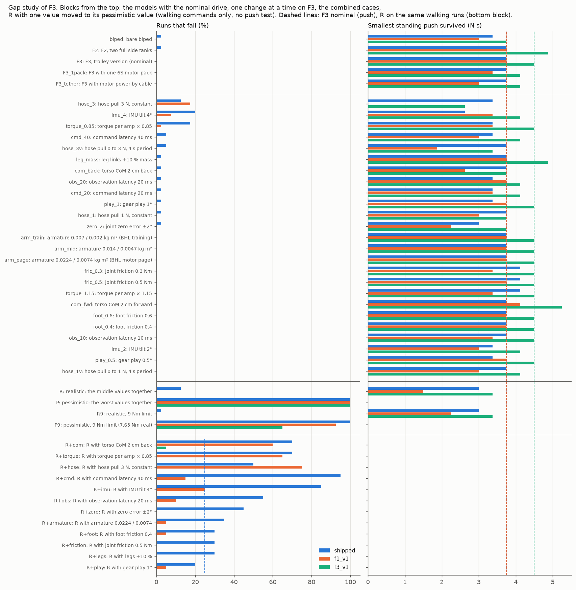

# Sim-to-real gap study of the trolley version F3

**Status:** tested in simulation (MuJoCo 3.15.0, CPU only). Nothing here is measured on board.

F3 is the trolley version of the robot (team decision of 2026-10-29).
The water tank and the pump hang high on a trolley that a teammate pushes behind the robot. Only the hose comes to the robot.
This study asks two questions:

1. How much does F3 help, compared with F2 and the bare biped?
2. Which differences between the simulation and the real robot most likely stop the real robot from walking?

The answers set the order of the hardware measurements and the randomization ranges of the next training.

## Answers

Status: tested in simulation, with the shipped BHL policy, f1_v1 and f3_v1. Details in "Findings" at the end.

1. F3 helps, mostly with torque margin. With the nominal drive, F2 and F3 fall at most once in 40 runs.
   F3 walks faster (0.25 against 0.22 m/s, shipped policy) and spends less time at the torque limit.
   F3 also tolerates drive errors better. 40 ms of command latency gives 2 falls in 40 runs on F3.
   On F2, it gives 13 (shipped policy, `hw_risks.py` case 5c).
2. The two lighter options (one 6S pack, motor power by cable) help a little more. They do not change the falls.
3. Alone, only three changes cause clear falls on F3: a constant 3 N hose pull, a 4° IMU tilt and 15 % less torque per amp.
4. Small errors add up. With the realistic case R, the shipped policy falls in 5 of 40 runs. f1_v1 does not fall.
   In R, five values cause many falls when they move to their pessimistic value.
   These are: torque per amp × 0.85, CoM 2 cm back, 3 N constant hose pull, 40 ms command latency, 4° IMU tilt.
5. The mechanical details matter less than expected: armature, joint friction, foot friction, leg mass and gear play.
6. With everything at the pessimistic value (case P), all 80 runs fall within 1 s. With a 9 Nm limit, 77 of 80 runs still fall.
7. Our policy f3_v1 trained with the recommended ranges below. It does not fall in R or in the 25 cases with one change.
   It falls once in the 240 runs of R with one value at its pessimistic value (CoM 2 cm back).
   It still falls in all 40 runs of P, and in 26 of 40 runs of P with a 9 Nm limit.
   These cases test the same kinds of errors as its training. So they do not prove that it walks on the robot.

## Ranking of the differences

Ranked by the extra falls in R (the realistic robot), then by the effect alone on F3 nominal.
The shipped policy and f1_v1 together. f3_v1 is not in the ranking, because it trained with these errors (answer 7).
"In R": 20 walking runs per policy. "Alone": 40 runs per policy. p is given when it is below 0.05.

| Rank | Difference | Extra falls alone (of 80) | Extra falls in R (of 40) | How to measure it |
|---|---|---|---|---|
| 1 | Torque per amp 15 % low (K, D and limit) | +8 (p < 0.01) | +22 (p < 0.01) | lever with a known mass, drive in torque mode |
| 2 | Torso CoM 2 cm back | +1 | +21 (p < 0.01) | weighed parts, then a balance test |
| 3 | Hose pull 3 N, constant | +12 (p < 0.01) | +20 (p < 0.01) | spring scale at the nozzle mount, trolley moving |
| 4 | IMU tilt 4° | +11 (p < 0.01) | +17 (p < 0.01) | gravity vector with the torso on a level table |
| 5 | Command latency 40 ms | +2 | +17 (p < 0.01) | time stamps in the policy loop |
| 6 | Observation latency 20 ms | +1 | +8 (p < 0.01) | time stamps in the policy loop |
| 7 | Joint zero error ±2° | +1 | +4 | zero jig |
| 8 | Armature 0.0224 / 0.0074 kg m² | 0 | +3 | free swing or step test of one actuator |
| 9 | Foot friction 0.4 | 0 | +2 | incline test on the demo floor |
| 10 | Joint friction 0.5 Nm | 0 | +1 | the same lever test as rank 1 |
| 10 | Leg mass +10 % | +1 | +1 | scale |
| 12 | Gear play 1° | +1 | 0 | lock the joint, rock the motor, read the encoder |

## Recommended order of hardware measurements

Status: planned. Measure first the differences with the largest effect. Each step gives the limit from this study.

1. **Torque per amp** of one hip or knee drive and one ankle drive. Put the drive in torque mode and hang a known mass on a lever.
   Find the current that just lifts the mass and the current that just lets it drop. Their mean gives the torque per amp.
   Half their difference gives the joint friction. Then set `current_lim` so that the joint really gets 6 Nm, or 9 Nm.
2. **Torso CoM in x.** Compute it from the weighed parts (planned), then check it with a balance test of the built torso.
   2 cm back already costs many falls in R. Move parts forward if the CoM is behind the model value.
3. **Hose pull** with the trolley. Put a spring scale between the hose and the nozzle mount while a teammate walks the trolley.
   Keep the mean pull below 1 N with a slack hose. A hose clamp lower on the torso would also tilt the robot less (not tested).
4. **IMU tilt.** Put the torso on a level table and read the gravity vector. This takes 5 minutes.
   Correct the offset in software if it is above 1°. 2° changed nothing, 4° caused falls.
5. **Loop latency** on the ROCK 3C. Log the times of the encoder sample, the policy step and the CAN send.
   Keep the total from the sensor sample to the new drive target at 20 ms or less, as `hw_risks.py` recommends.
6. **Joint zero error.** Check each joint with a jig after the zero procedure. Aim for ±1°, as `hw_risks.py` recommends.
7. **Last:** armature, foot friction, leg masses and gear play. They changed the falls by 3 or less in this study.

## Recommended randomization ranges for the next training

Status: planned. The column "f1_v1" gives the ranges of its last training stage (`sim/rl/policies/f1_v1.json`, `sim/rl/f1_env.py`).
The recommended ranges cover the tested values with some margin.
f3_v1 (stage E) uses them, with a constant hose pull of 0 to 2.5 N plus a changing pull of 0 to 1.5 N ([sim/rl](../../rl/README.md)).

| Term | f1_v1 | Recommended | Reason |
|---|---|---|---|
| Torque per amp: one scale on K, D and the torque limit together | none (K and D × 0.8 to 1.2 for each joint, limit 6 to 9 Nm) | × 0.8 to 1.2, on top of the K and D ranges | rank 1. A torque constant error moves K, D and the limit together |
| Torso CoM, torso and payload together | ±3 cm in x, y and z | keep ±3 cm | rank 2 |
| Hose pull at the nozzle (0.03, 0, 0.944) m, horizontal, backward in the heading frame | none (recoil 0 to 1.5 N along the nozzle, constant force on the torso ±1 N) | 0 to 4 N: a constant part per episode plus a slow change (period 2 to 8 s) | rank 3. The constant part hurts most |
| IMU tilt: one fixed rotation of the gravity and gyro inputs, random axis | none (only the noise of ±0.05) | 0 to 5° | rank 4. The noise does not teach a constant offset |
| Command latency | 0 to 20 ms | 0 to 40 ms | rank 5. f1_v1, trained to 20 ms, falls much less than the shipped policy at 40 ms |
| Observation latency | 0 to 20 ms | keep 0 to 20 ms | rank 6 |
| Joint zero error | ±0.05 rad (±2.9°) | keep | rank 7 |
| Armature, hip and knee / ankle | 0.004 to 0.008 kg m², all joints | 0.007 to 0.025 / 0.002 to 0.008 kg m² | small effect, but the true value is unknown |
| Joint friction | 0.05 to 0.15 Nm | 0.05 to 0.5 Nm | no extra falls, but it slows the turn on the spot |
| Leg link mass | none | × 0.9 to 1.1 | small effect |
| Foot friction | 0.4 to 1.2 | keep | 0.4 changed nothing on a flat floor |
| Gear play | none | not needed now | no effect with this simple model |

**Assumed:** the realistic case R is a guess of the real robot. Measure the ranked values, then run the study again with them.
**Not verified:** the hose model is a horizontal force at the nozzle. A real hose also pulls down and sideways, and it moves with the pan-tilt.
**Not verified:** the motor speed limit is not in the model. The fastest joint in the F3 nominal runs reached 13.3 rad/s.
At 22.2 V, the no-load speed at the joint is about 23 rad/s (150KV, hip and knee) and 17 rad/s (110KV, ankle).
**Open:** the BHL training config sets a velocity limit of 10 rad/s. We do not know if Isaac Lab applied it to the joints.
**Open:** every run starts with the BHL 4 cm drop. A start from a gantry is gentler. P falls during this phase.

## Setup

- Loop: `hw_risks.simulate()`. This is the `run.py` policy loop with the drive model of `hw_risks.py`.
  Policy at 25 Hz, physics at 2 kHz, the training observation noise, and the BHL start with a 4 cm drop.
- Nominal drive (`hw_risks.py` case 1): K = 20 Nm/rad, D = 2 Nm s/rad, 6 Nm torque limit, PASSTHROUGH input mode.
  No zero error, no latency.
- Policies: the shipped BHL policy and our policy f1_v1. f1_v1 was trained on F1 (15.24 kg). Both have the same 45 inputs and 12 outputs.
- Commands: stand, vx 0.3 m/s, turn on the spot at 0.5 rad/s, and vx 0.2 m/s + yaw 0.5 rad/s. 10 seeds per command, 20 s per run.
  So each case has 40 runs per policy.
- Seeds: the seed sets the sensor noise, the zero errors, the IMU tilt axis and the phase of the varying hose pull.
  All cases use the same seeds. So each run of a case pairs with one run of F3 nominal (same policy, command and seed).
- Push test: the robot stands with a zero command. A 0.1 s push hits the torso forward, back, left or right, at 3.0 s or 3.3 s.
  A bisection finds the largest push with no fall in the next 3 s (resolution 0.375 N s).
  "Smallest standing push" is the smallest of these 8 values. 0 means that the robot fell without a push.
- Fall: a torso tilt above 0.78 rad or a large height drop, as in `run.py`.
- Knee: F3 has no side tanks. So this study does not clip the knee target at 1.4 rad, unlike `sim/rl/f1_eval.py`.

### The changes

| Change | Values tested | Nominal | Source of the values |
|---|---|---|---|
| Joint armature, hip and knee / ankle (kg m²) | 0.007 / 0.002, 0.014 / 0.0047, 0.0224 / 0.0074 | 0.005 / 0.005 | BHL Isaac Lab training config, the middle, BHL motor page |
| Joint friction (`frictionloss`, Nm) | 0.3, 0.5 | 0.1 | BHL model value and two higher guesses |
| Torque per amp: K, D and the torque limit together | × 0.85, × 1.15 | × 1 | BHL and the course config use different torque constants |
| Leg link mass and inertia, 12 bodies | +10 % (+0.82 kg) | CAD values | printed parts, screws and cables |
| Torso CoM in x: the torso and all payload parts | +2 cm, −2 cm | model | |
| Foot friction (all geoms) | 0.6, 0.4 | 1.0 | BHL training range 0.4 to 1.2 |
| Observation latency | 10 ms, 20 ms | 0 | `hw_risks.py` model |
| Command latency | 20 ms, 40 ms | 0 | `hw_risks.py` model |
| IMU mounting tilt | 2°, 4° | 0 | |
| Gear play (backlash) at the joint | 0.5°, 1° | 0 | model below |
| Hose pull at the nozzle | 1 N, 3 N, constant or from 0 to the value and back in 4 s | 0 | |
| Joint zero error | ±2° | 0 | `hw_risks.py` case 4b |

- Armature: the BHL motor page gives a reflected rotor inertia of 0.0224 kg m² (M6C12, hip and knee) and 0.00743 kg m² (5010, ankle).
  The page uses a thin-shell rotor, which probably gives too much. So the true value is probably between the training value and the page value.
- Torque per amp: the drive turns the gains into a current with its configured torque constant.
  A wrong torque constant scales K, D and the torque limit together. BHL uses 0.0919 and 0.1176 Nm/A, the course config 0.067 and 0.0836 Nm/A.
- IMU tilt: the IMU frame turns about a horizontal axis. The seed sets the direction of the axis.
  The policy sees the turned gravity and gyro vectors. The fall check uses the true torso.
- Hose pull: a horizontal force, backward in the heading frame, at the nozzle point (0.03, 0, 0.944) m of the torso frame.
  The seed sets the phase of the varying pull.
- Joint zero error: we added it because `hw_risks.py` found that ±2° matters on F2.

**Assumed:** the gear play model. It is simple, so read its results as a first estimate:

- The drive measures the rotor (the motor encoder) and turns the rotor. The rotor has no mass.
- The rotor pushes the joint only when it touches a wall of the play. Then the joint gets the drive torque, and the rotor turns with the joint.
- Between the walls, the joint gets no torque. The rotor turns at the speed where the drive torque is zero: K × (target − rotor) / D.
- The policy sees the rotor position and speed, as on the real robot.
- So the position loop has a dead band of ± half the play, and the measured joint position is off by up to ± half the play.
- Not in the model: the rotor inertia while it crosses the gap, the impact at the wall, and the gear stiffness.

### Combined cases

| Case | Changes |
|---|---|
| R: realistic | armature 0.014 / 0.0047, joint friction 0.3 Nm, legs +5 %, foot friction 0.6, observation latency 10 ms, command latency 20 ms, IMU tilt 2°, gear play 0.5°, hose 0 to 1 N (4 s), zero error ±1°. Torque per amp × 1 and torso CoM 0 (the middle of their ranges) |
| P: pessimistic | armature 0.0224 / 0.0074, joint friction 0.5 Nm, torque per amp × 0.85, legs +10 %, torso CoM 2 cm back, foot friction 0.4, observation latency 20 ms, command latency 40 ms, IMU tilt 4°, gear play 1°, hose 3 N constant, zero error ±2° |
| R9, P9 | R and P with a 9 Nm drive limit. In P9, the torque per amp error makes it 7.65 Nm at the joint |
| R+armature to R+zero | R with one value moved to its value in P. These 12 cases run only the two walking commands (20 runs per policy) and no push test, to save compute time |

- P takes the worse direction of the two-sided changes: the torso CoM 2 cm back and the constant hose pull.
  The one-change results confirmed both choices.

Metrics:

- Falls: runs that fall in 20 s. Speeds: the mean from 5 s to 20 s of the runs without a fall.
- Change in falls: the falls of a case minus the falls of F3 nominal, summed over the policies.
- p: the exact McNemar test of the paired runs. It counts the pairs where only one of the two runs falls.
  A p below 0.05 means that the change is probably not noise. A change of 5 falls or less never reaches p < 0.05.
- Torque at the limit: the share of the physics steps where a joint asks for more than its limit.

## Results

### Policies

| Name | File |
|---|---|
| shipped | `sim/sim2sim/policy_biped_25hz_a.onnx` |
| f1_v1 | `sim/rl/policies/f1_v1.onnx` |
| f3_v1 | `sim/rl/policies/f3_v1.onnx` |

### 1. Model comparison (nominal drive: hw_risks case 1)

Falls in 40 runs. Speeds: mean of the runs without a fall, from 5 s to 20 s. Push: the smallest standing push survived, over 4 directions and 2 push times, and its direction.

| Model | Mass (kg) | CoM height (m) | Policy | Falls | vx at cmd 0.3 (m/s) | Yaw rate, turn on the spot 0.5 (rad/s) | vx, yaw rate at cmd 0.2 + 0.5 | Smallest standing push (N s) |
|---|---|---|---|---|---|---|---|---|
| biped: bare biped | 11.34 | 0.363 | shipped | 1 of 40 | 0.29 | 0.10 | 0.18, 0.48 | 3.4 right |
| biped: bare biped | 11.34 | 0.363 | f1_v1 | 0 of 40 | 0.22 | 0.49 | 0.16, 0.49 | 3.0 back |
| biped: bare biped | 11.34 | 0.363 | f3_v1 | 0 of 40 | 0.24 | 0.49 | 0.14, 0.53 | 3.8 back |
| F2: F2, two full side tanks | 15.99 | 0.449 | shipped | 1 of 40 | 0.22 | 0.02 | 0.11, 0.43 | 3.8 right |
| F2: F2, two full side tanks | 15.99 | 0.449 | f1_v1 | 0 of 40 | 0.15 | 0.39 | 0.10, 0.39 | 3.8 back |
| F2: F2, two full side tanks | 15.99 | 0.449 | f3_v1 | 0 of 40 | 0.20 | 0.43 | 0.12, 0.46 | 4.9 back |
| F3: F3, trolley version (nominal) | 14.58 | 0.431 | shipped | 0 of 40 | 0.25 | 0.03 | 0.13, 0.45 | 3.8 right |
| F3: F3, trolley version (nominal) | 14.58 | 0.431 | f1_v1 | 0 of 40 | 0.17 | 0.44 | 0.12, 0.43 | 3.8 back |
| F3: F3, trolley version (nominal) | 14.58 | 0.431 | f3_v1 | 0 of 40 | 0.21 | 0.45 | 0.14, 0.48 | 4.5 back |
| F3_1pack: F3 with one 6S motor pack | 13.98 | 0.424 | shipped | 0 of 40 | 0.26 | 0.03 | 0.13, 0.45 | 3.8 right |
| F3_1pack: F3 with one 6S motor pack | 13.98 | 0.424 | f1_v1 | 0 of 40 | 0.18 | 0.46 | 0.13, 0.45 | 3.4 back |
| F3_1pack: F3 with one 6S motor pack | 13.98 | 0.424 | f3_v1 | 0 of 40 | 0.21 | 0.46 | 0.14, 0.49 | 4.1 back |
| F3_tether: F3 with motor power by cable | 13.44 | 0.418 | shipped | 0 of 40 | 0.27 | 0.04 | 0.14, 0.46 | 3.8 right |
| F3_tether: F3 with motor power by cable | 13.44 | 0.418 | f1_v1 | 0 of 40 | 0.19 | 0.49 | 0.14, 0.47 | 3.0 back |
| F3_tether: F3 with motor power by cable | 13.44 | 0.418 | f3_v1 | 0 of 40 | 0.22 | 0.47 | 0.15, 0.49 | 4.1 back |

### 2. Joint torque while walking (cmd vx 0.3, nominal drive)

Share of the time at the torque limit (6 Nm), mean of both legs and all 10 runs, from 1 s to the end or the fall. Peak: the largest torque in the 10 runs. The drive clips at 6 Nm, so 6.0 means that the joint reached the limit.

| Model | Policy | hip roll (%) | hip yaw (%) | hip pitch (%) | knee (%) | ankle pitch (%) | ankle roll (%) | Peak hip pitch (Nm) | Peak knee (Nm) |
|---|---|---|---|---|---|---|---|---|---|
| biped | shipped | 3.0 | 7.4 | 2.9 | 8.5 | 18.2 | 0.1 | 6.0 | 6.0 |
| biped | f1_v1 | 7.5 | 10.7 | 0.1 | 7.8 | 5.7 | 0.0 | 6.0 | 6.0 |
| biped | f3_v1 | 6.8 | 9.2 | 0.3 | 1.8 | 9.4 | 0.0 | 6.0 | 6.0 |
| F2 | shipped | 12.7 | 29.2 | 8.3 | 26.5 | 22.9 | 0.3 | 6.0 | 6.0 |
| F2 | f1_v1 | 13.0 | 30.5 | 0.6 | 19.2 | 5.6 | 0.0 | 6.0 | 6.0 |
| F2 | f3_v1 | 13.0 | 8.2 | 3.7 | 3.3 | 11.4 | 0.0 | 6.0 | 6.0 |
| F3 | shipped | 10.8 | 22.6 | 6.8 | 20.7 | 20.1 | 0.2 | 6.0 | 6.0 |
| F3 | f1_v1 | 11.3 | 23.5 | 0.3 | 16.3 | 4.6 | 0.0 | 6.0 | 6.0 |
| F3 | f3_v1 | 8.9 | 9.4 | 0.9 | 2.5 | 10.3 | 0.0 | 6.0 | 6.0 |
| F3_1pack | shipped | 8.7 | 18.9 | 6.2 | 18.7 | 19.5 | 0.1 | 6.0 | 6.0 |
| F3_1pack | f1_v1 | 9.0 | 19.5 | 0.3 | 14.9 | 5.1 | 0.0 | 6.0 | 6.0 |
| F3_1pack | f3_v1 | 7.1 | 9.0 | 0.5 | 2.3 | 9.9 | 0.0 | 6.0 | 6.0 |
| F3_tether | shipped | 7.0 | 16.0 | 5.1 | 16.9 | 17.9 | 0.1 | 6.0 | 6.0 |
| F3_tether | f1_v1 | 5.8 | 17.1 | 0.2 | 14.4 | 4.9 | 0.0 | 6.0 | 6.0 |
| F3_tether | f3_v1 | 5.4 | 9.0 | 0.4 | 2.1 | 9.6 | 0.0 | 6.0 | 6.0 |

### 3. One change at a time on F3 (nominal drive)

Change in falls: falls of the case minus falls of F3 nominal, summed over the policies. p: exact McNemar test of the paired runs (same policy, command and seed). A p below 0.05 means that the change is probably not noise.

| Case | Falls (shipped / f1_v1 / f3_v1) | Change in falls, all policies | p | vx at cmd 0.3 (m/s) | Yaw rate, turn on the spot 0.5 (rad/s) | Smallest standing push (N s) |
|---|---|---|---|---|---|---|
| F3: F3, trolley version (nominal) | 0 of 40 / 0 of 40 / 0 of 40 | - | - | 0.25 / 0.17 / 0.21 | 0.03 / 0.44 / 0.45 | 3.8 / 3.8 / 4.5 |
| arm_train: armature 0.007 / 0.002 kg m² (BHL training) | 0 of 40 / 0 of 40 / 0 of 40 | +0 | 1.00 | 0.24 / 0.18 / 0.21 | 0.03 / 0.44 / 0.46 | 3.8 / 3.8 / 4.5 |
| arm_mid: armature 0.014 / 0.0047 kg m² | 0 of 40 / 0 of 40 / 0 of 40 | +0 | 1.00 | 0.25 / 0.18 / 0.22 | 0.02 / 0.45 / 0.47 | 3.8 / 3.8 / 4.5 |
| arm_page: armature 0.0224 / 0.0074 kg m² (BHL motor page) | 0 of 40 / 0 of 40 / 0 of 40 | +0 | 1.00 | 0.26 / 0.19 / 0.22 | 0.02 / 0.46 / 0.48 | 3.8 / 3.8 / 4.5 |
| fric_0.3: joint friction 0.3 Nm | 0 of 40 / 0 of 40 / 0 of 40 | +0 | 1.00 | 0.24 / 0.17 / 0.20 | 0.02 / 0.39 / 0.42 | 4.1 / 3.4 / 4.5 |
| fric_0.5: joint friction 0.5 Nm | 0 of 40 / 0 of 40 / 0 of 40 | +0 | 1.00 | 0.24 / 0.16 / 0.19 | 0.01 / 0.32 / 0.38 | 4.1 / 3.8 / 4.5 |
| torque_0.85: torque per amp × 0.85 | 7 of 40 / 1 of 40 / 0 of 40 | +8 | < 0.01 | 0.17 / 0.10 / 0.17 | 0.01 / 0.32 / 0.39 | 3.4 / 3.4 / 4.5 |
| torque_1.15: torque per amp × 1.15 | 0 of 40 / 0 of 40 / 0 of 40 | +0 | 1.00 | 0.28 / 0.21 / 0.24 | 0.07 / 0.50 / 0.48 | 4.1 / 3.4 / 4.5 |
| leg_mass: leg links +10 % mass | 1 of 40 / 0 of 40 / 0 of 40 | +1 | 1.00 | 0.22 / 0.15 / 0.20 | 0.01 / 0.40 / 0.43 | 3.8 / 3.8 / 4.9 |
| com_fwd: torso CoM 2 cm forward | 0 of 40 / 0 of 40 / 0 of 40 | +0 | 1.00 | 0.28 / 0.21 / 0.23 | 0.03 / 0.42 / 0.45 | 3.8 / 4.1 / 5.2 |
| com_back: torso CoM 2 cm back | 1 of 40 / 0 of 40 / 0 of 40 | +1 | 1.00 | 0.19 / 0.12 / 0.18 | 0.02 / 0.43 / 0.44 | 3.8 / 2.6 / 3.8 |
| foot_0.6: foot friction 0.6 | 0 of 40 / 0 of 40 / 0 of 40 | +0 | 1.00 | 0.24 / 0.17 / 0.21 | 0.02 / 0.43 / 0.47 | 3.8 / 3.8 / 4.5 |
| foot_0.4: foot friction 0.4 | 0 of 40 / 0 of 40 / 0 of 40 | +0 | 1.00 | 0.26 / 0.18 / 0.21 | 0.02 / 0.42 / 0.46 | 3.8 / 3.8 / 4.5 |
| obs_10: observation latency 10 ms | 0 of 40 / 0 of 40 / 0 of 40 | +0 | 1.00 | 0.25 / 0.18 / 0.22 | 0.03 / 0.46 / 0.49 | 3.8 / 3.4 / 4.5 |
| obs_20: observation latency 20 ms | 1 of 40 / 0 of 40 / 0 of 40 | +1 | 1.00 | 0.25 / 0.18 / 0.22 | 0.08 / 0.48 / 0.51 | 3.4 / 3.8 / 4.1 |
| cmd_20: command latency 20 ms | 1 of 40 / 0 of 40 / 0 of 40 | +1 | 1.00 | 0.25 / 0.18 / 0.22 | 0.05 / 0.48 / 0.49 | 3.4 / 3.4 / 4.1 |
| cmd_40: command latency 40 ms | 2 of 40 / 0 of 40 / 0 of 40 | +2 | 0.50 | 0.24 / 0.18 / 0.22 | 0.33 / 0.45 / 0.53 | 3.4 / 3.0 / 4.1 |
| imu_2: IMU tilt 2° | 0 of 40 / 0 of 40 / 0 of 40 | +0 | 1.00 | 0.24 / 0.16 / 0.20 | 0.03 / 0.42 / 0.43 | 3.4 / 3.0 / 4.1 |
| imu_4: IMU tilt 4° | 8 of 40 / 3 of 40 / 0 of 40 | +11 | < 0.01 | 0.24 / 0.14 / 0.18 | 0.03 / 0.39 / 0.36 | 2.6 / 3.4 / 4.1 |
| play_0.5: gear play 0.5° | 0 of 40 / 0 of 40 / 0 of 40 | +0 | 1.00 | 0.24 / 0.17 / 0.21 | 0.02 / 0.42 / 0.42 | 3.4 / 3.8 / 4.5 |
| play_1: gear play 1° | 1 of 40 / 0 of 40 / 0 of 40 | +1 | 1.00 | 0.24 / 0.16 / 0.21 | 0.01 / 0.40 / 0.38 | 3.4 / 3.8 / 4.5 |
| hose_1: hose pull 1 N, constant | 1 of 40 / 0 of 40 / 0 of 40 | +1 | 1.00 | 0.21 / 0.14 / 0.18 | 0.03 / 0.45 / 0.46 | 3.8 / 3.0 / 3.8 |
| hose_3: hose pull 3 N, constant | 5 of 40 / 7 of 40 / 0 of 40 | +12 | < 0.01 | 0.12 / 0.09 / 0.13 | 0.09 / 0.42 / 0.46 | 3.4 / 0.0 / 2.6 |
| hose_1v: hose pull 0 to 1 N, 4 s period | 0 of 40 / 0 of 40 / 0 of 40 | +0 | 1.00 | 0.23 / 0.16 / 0.20 | 0.03 / 0.44 / 0.45 | 3.8 / 3.0 / 4.1 |
| hose_3v: hose pull 0 to 3 N, 4 s period | 2 of 40 / 0 of 40 / 0 of 40 | +2 | 0.50 | 0.19 / 0.13 / 0.17 | 0.04 / 0.44 / 0.46 | 3.8 / 1.9 / 3.4 |
| zero_2: joint zero error ±2° | 1 of 40 / 0 of 40 / 0 of 40 | +1 | 1.00 | 0.24 / 0.17 / 0.21 | 0.03 / 0.43 / 0.45 | 3.0 / 2.2 / 3.8 |

### 4. Factors sorted by the effect of one change on F3

Sorted by the largest change in falls of any tested value, over all policies. The main ranking at the top also uses R.

| Rank | Factor | Values tested: change in falls (p) |
|---|---|---|
| 1 | hose pull | hose_1: +1 (p 1.00), hose_3: +12 (p < 0.01), hose_1v: +0 (p 1.00), hose_3v: +2 (p 0.50) |
| 2 | IMU tilt | imu_2: +0 (p 1.00), imu_4: +11 (p < 0.01) |
| 3 | torque per amp | torque_0.85: +8 (p < 0.01), torque_1.15: +0 (p 1.00) |
| 4 | command latency | cmd_20: +1 (p 1.00), cmd_40: +2 (p 0.50) |
| 5 | leg mass | leg_mass: +1 (p 1.00) |
| 6 | torso CoM | com_fwd: +0 (p 1.00), com_back: +1 (p 1.00) |
| 7 | observation latency | obs_10: +0 (p 1.00), obs_20: +1 (p 1.00) |
| 8 | gear play | play_0.5: +0 (p 1.00), play_1: +1 (p 1.00) |
| 9 | zero error | zero_2: +1 (p 1.00) |
| 10 | armature | arm_train: +0 (p 1.00), arm_mid: +0 (p 1.00), arm_page: +0 (p 1.00) |
| 11 | joint friction | fric_0.3: +0 (p 1.00), fric_0.5: +0 (p 1.00) |
| 12 | foot friction | foot_0.6: +0 (p 1.00), foot_0.4: +0 (p 1.00) |

### 5. Combined cases on F3

| Case | Falls (shipped / f1_v1 / f3_v1) | Change in falls, all policies | p | vx at cmd 0.3 (m/s) | Yaw rate, turn on the spot 0.5 (rad/s) | Smallest standing push (N s) |
|---|---|---|---|---|---|---|
| F3: F3, trolley version (nominal) | 0 of 40 / 0 of 40 / 0 of 40 | - | - | 0.25 / 0.17 / 0.21 | 0.03 / 0.44 / 0.45 | 3.8 / 3.8 / 4.5 |
| R: realistic: the middle values together | 5 of 40 / 0 of 40 / 0 of 40 | +5 | 0.06 | 0.22 / 0.15 / 0.18 | 0.09 / 0.41 / 0.47 | 3.0 / 1.5 / 3.4 |
| P: pessimistic: the worst values together | 40 of 40 / 40 of 40 / 40 of 40 | +120 | < 0.01 | - / - / - | - / - / - | 0.0 / 0.0 / 0.0 |
| R9: realistic, 9 Nm limit | 1 of 40 / 0 of 40 / 0 of 40 | +1 | 1.00 | 0.26 / 0.19 / 0.19 | 0.07 / 0.46 / 0.48 | 3.0 / 2.2 / 3.4 |
| P9: pessimistic, 9 Nm limit (7.65 Nm real) | 40 of 40 / 37 of 40 / 26 of 40 | +103 | < 0.01 | - / - / 0.07 | - / 0.35 / 0.29 | 0.0 / 0.0 / 0.0 |

### 6. The realistic case R with one value moved to its pessimistic value

These cases run only the two walking commands (vx 0.3 and vx 0.2 + yaw 0.5), 10 seeds each, without the push test. The row of R counts the same 20 runs per policy. Change and p are against R. Sorted by the change in falls.

| Case | Falls (shipped / f1_v1 / f3_v1) | Change in falls, all policies | p | vx at cmd 0.3 (m/s) | vx, yaw rate at cmd 0.2 + 0.5 |
|---|---|---|---|---|---|
| R: realistic: the middle values together | 5 of 20 / 0 of 20 / 0 of 20 | - | - | 0.22 / 0.15 / 0.18 | 0.14, 0.48 / 0.12, 0.40 / 0.12, 0.45 |
| R+com: R with torso CoM 2 cm back | 14 of 20 / 12 of 20 / 1 of 20 | +22 | < 0.01 | 0.17 / 0.11 / 0.15 | 0.11, 0.43 / 0.10, 0.36 / 0.10, 0.43 |
| R+torque: R with torque per amp × 0.85 | 14 of 20 / 13 of 20 / 0 of 20 | +22 | < 0.01 | 0.18 / 0.13 / 0.15 | 0.13, 0.44 / 0.08, 0.32 / 0.08, 0.41 |
| R+hose: R with hose pull 3 N, constant | 10 of 20 / 15 of 20 / 0 of 20 | +20 | < 0.01 | 0.11 / 0.10 / 0.11 | 0.07, 0.38 / 0.09, 0.38 / 0.07, 0.45 |
| R+cmd: R with command latency 40 ms | 19 of 20 / 3 of 20 / 0 of 20 | +17 | < 0.01 | - / 0.15 / 0.18 | 0.12, 0.50 / 0.12, 0.40 / 0.12, 0.47 |
| R+imu: R with IMU tilt 4° | 17 of 20 / 5 of 20 / 0 of 20 | +17 | < 0.01 | 0.08 / 0.16 / 0.17 | 0.14, 0.42 / 0.11, 0.38 / 0.10, 0.43 |
| R+obs: R with observation latency 20 ms | 11 of 20 / 2 of 20 / 0 of 20 | +8 | < 0.01 | 0.23 / 0.16 / 0.18 | 0.14, 0.46 / 0.11, 0.38 / 0.11, 0.46 |
| R+zero: R with zero error ±2° | 9 of 20 / 0 of 20 / 0 of 20 | +4 | 0.12 | 0.24 / 0.15 / 0.18 | 0.13, 0.47 / 0.11, 0.39 / 0.12, 0.46 |
| R+armature: R with armature 0.0224 / 0.0074 | 7 of 20 / 1 of 20 / 0 of 20 | +3 | 0.51 | 0.23 / 0.16 / 0.18 | 0.15, 0.47 / 0.12, 0.40 / 0.12, 0.46 |
| R+foot: R with foot friction 0.4 | 6 of 20 / 1 of 20 / 0 of 20 | +2 | 0.73 | 0.24 / 0.16 / 0.18 | 0.14, 0.46 / 0.12, 0.39 / 0.12, 0.47 |
| R+friction: R with joint friction 0.5 Nm | 6 of 20 / 0 of 20 / 0 of 20 | +1 | 1.00 | 0.22 / 0.14 / 0.17 | 0.13, 0.45 / 0.11, 0.34 / 0.11, 0.41 |
| R+legs: R with legs +10 % | 6 of 20 / 0 of 20 / 0 of 20 | +1 | 1.00 | 0.21 / 0.14 / 0.18 | 0.11, 0.46 / 0.11, 0.38 / 0.11, 0.45 |
| R+play: R with gear play 1° | 4 of 20 / 1 of 20 / 0 of 20 | +0 | 1.00 | 0.21 / 0.15 / 0.18 | 0.13, 0.46 / 0.11, 0.39 / 0.11, 0.45 |

### 7. Falls per command (stand / vx 0.3 / yaw 0.5 / vx 0.2 + yaw 0.5)

| Case | shipped | f1_v1 | f3_v1 |
|---|---|---|---|
| biped | 0 / 0 / 0 / 1 | 0 / 0 / 0 / 0 | 0 / 0 / 0 / 0 |
| F2 | 0 / 0 / 0 / 1 | 0 / 0 / 0 / 0 | 0 / 0 / 0 / 0 |
| F3 | 0 / 0 / 0 / 0 | 0 / 0 / 0 / 0 | 0 / 0 / 0 / 0 |
| F3_1pack | 0 / 0 / 0 / 0 | 0 / 0 / 0 / 0 | 0 / 0 / 0 / 0 |
| F3_tether | 0 / 0 / 0 / 0 | 0 / 0 / 0 / 0 | 0 / 0 / 0 / 0 |
| arm_train | 0 / 0 / 0 / 0 | 0 / 0 / 0 / 0 | 0 / 0 / 0 / 0 |
| arm_mid | 0 / 0 / 0 / 0 | 0 / 0 / 0 / 0 | 0 / 0 / 0 / 0 |
| arm_page | 0 / 0 / 0 / 0 | 0 / 0 / 0 / 0 | 0 / 0 / 0 / 0 |
| fric_0.3 | 0 / 0 / 0 / 0 | 0 / 0 / 0 / 0 | 0 / 0 / 0 / 0 |
| fric_0.5 | 0 / 0 / 0 / 0 | 0 / 0 / 0 / 0 | 0 / 0 / 0 / 0 |
| torque_0.85 | 0 / 2 / 0 / 5 | 0 / 1 / 0 / 0 | 0 / 0 / 0 / 0 |
| torque_1.15 | 0 / 0 / 0 / 0 | 0 / 0 / 0 / 0 | 0 / 0 / 0 / 0 |
| leg_mass | 0 / 0 / 0 / 1 | 0 / 0 / 0 / 0 | 0 / 0 / 0 / 0 |
| com_fwd | 0 / 0 / 0 / 0 | 0 / 0 / 0 / 0 | 0 / 0 / 0 / 0 |
| com_back | 0 / 0 / 0 / 1 | 0 / 0 / 0 / 0 | 0 / 0 / 0 / 0 |
| foot_0.6 | 0 / 0 / 0 / 0 | 0 / 0 / 0 / 0 | 0 / 0 / 0 / 0 |
| foot_0.4 | 0 / 0 / 0 / 0 | 0 / 0 / 0 / 0 | 0 / 0 / 0 / 0 |
| obs_10 | 0 / 0 / 0 / 0 | 0 / 0 / 0 / 0 | 0 / 0 / 0 / 0 |
| obs_20 | 0 / 1 / 0 / 0 | 0 / 0 / 0 / 0 | 0 / 0 / 0 / 0 |
| cmd_20 | 0 / 0 / 0 / 1 | 0 / 0 / 0 / 0 | 0 / 0 / 0 / 0 |
| cmd_40 | 0 / 0 / 0 / 2 | 0 / 0 / 0 / 0 | 0 / 0 / 0 / 0 |
| imu_2 | 0 / 0 / 0 / 0 | 0 / 0 / 0 / 0 | 0 / 0 / 0 / 0 |
| imu_4 | 0 / 4 / 0 / 4 | 1 / 2 / 0 / 0 | 0 / 0 / 0 / 0 |
| play_0.5 | 0 / 0 / 0 / 0 | 0 / 0 / 0 / 0 | 0 / 0 / 0 / 0 |
| play_1 | 0 / 0 / 0 / 1 | 0 / 0 / 0 / 0 | 0 / 0 / 0 / 0 |
| hose_1 | 0 / 0 / 0 / 1 | 0 / 0 / 0 / 0 | 0 / 0 / 0 / 0 |
| hose_3 | 0 / 1 / 3 / 1 | 2 / 5 / 0 / 0 | 0 / 0 / 0 / 0 |
| hose_1v | 0 / 0 / 0 / 0 | 0 / 0 / 0 / 0 | 0 / 0 / 0 / 0 |
| hose_3v | 0 / 0 / 0 / 2 | 0 / 0 / 0 / 0 | 0 / 0 / 0 / 0 |
| zero_2 | 0 / 1 / 0 / 0 | 0 / 0 / 0 / 0 | 0 / 0 / 0 / 0 |
| R | 0 / 3 / 0 / 2 | 0 / 0 / 0 / 0 | 0 / 0 / 0 / 0 |
| P | 10 / 10 / 10 / 10 | 10 / 10 / 10 / 10 | 10 / 10 / 10 / 10 |
| R9 | 0 / 1 / 0 / 0 | 0 / 0 / 0 / 0 | 0 / 0 / 0 / 0 |
| P9 | 10 / 10 / 10 / 10 | 10 / 10 / 8 / 9 | 9 / 6 / 6 / 5 |
| R+armature | - / 2 / - / 5 | - / 1 / - / 0 | - / 0 / - / 0 |
| R+friction | - / 2 / - / 4 | - / 0 / - / 0 | - / 0 / - / 0 |
| R+legs | - / 2 / - / 4 | - / 0 / - / 0 | - / 0 / - / 0 |
| R+com | - / 7 / - / 7 | - / 7 / - / 5 | - / 1 / - / 0 |
| R+foot | - / 3 / - / 3 | - / 1 / - / 0 | - / 0 / - / 0 |
| R+torque | - / 7 / - / 7 | - / 8 / - / 5 | - / 0 / - / 0 |
| R+obs | - / 6 / - / 5 | - / 2 / - / 0 | - / 0 / - / 0 |
| R+cmd | - / 10 / - / 9 | - / 2 / - / 1 | - / 0 / - / 0 |
| R+imu | - / 9 / - / 8 | - / 4 / - / 1 | - / 0 / - / 0 |
| R+play | - / 1 / - / 3 | - / 1 / - / 0 | - / 0 / - / 0 |
| R+hose | - / 4 / - / 6 | - / 8 / - / 7 | - / 0 / - / 0 |
| R+zero | - / 6 / - / 3 | - / 0 / - / 0 | - / 0 / - / 0 |

## Findings

Status: tested in simulation, with the shipped policy, f1_v1 and f3_v1 (runs of 2026-10-30). Most important first.

1. **Small errors add up, and the margin is thin.** The realistic case R makes the shipped policy fall in 5 of 40 runs (p = 0.06).
   f1_v1 does not fall in R. In R, one value at its pessimistic value gives these extra falls in 40 paired walking runs (p < 0.01):
   - torque per amp × 0.85: +22
   - torso CoM 2 cm back: +21
   - constant 3 N hose pull: +20
   - IMU tilt 4°: +17
   - command latency 40 ms: +17
   - observation latency 20 ms: +8

   The other values give +4 or less.
2. **The CoM shift and the command latency hurt only together with other errors.** Alone on F3, they give 1 and 2 falls in 80 runs.
   In R, they give +21 and +17. So a test of one error at a time on an ideal robot misses them.
   Alone, the CoM 2 cm back already slows walking by 0.05 to 0.06 m/s.
3. **Knee torque is the common thread.** The three worst values all make the knee hit its 6 Nm limit more often.
   At vx 0.3 on F3, the knee is at the limit 21 % (shipped) and 16 % (f1_v1) of the time.
   With the CoM 2 cm back or a constant 3 N pull, it is 28 to 38 %. In R with one of the three worst values, it is 40 to 57 %.
   A 9 Nm limit cuts the falls of the shipped policy in R from 5 to 1 in 40.
4. **A constant backward hose pull is the strongest single change on F3.** 3 N gives +12 falls in 80 runs, and the walking speed drops by about half.
   f1_v1 even falls in 2 of 10 standing runs with this pull. A pull that swings from 0 to 3 N gives only +2. The mean pull matters most.
5. **A 4° IMU tilt causes falls, 2° does not.** 4° gives +11 falls in 80 runs. The policies then see a constant gravity error of 0.07.
   This is larger than the training noise of ±0.05.
6. **15 % less torque per amp causes falls alone too.** × 0.85 gives +8 falls in 80 runs and slows walking from 0.25 to 0.17 m/s (shipped).
   × 1.15 gives no falls and faster walking.
7. **F3 tolerates drive errors better than F2.** With the shipped policy and the same seeds, 40 ms of command latency gives 2 falls in 40 runs on F3.
   `hw_risks.py` case 5c gives 13 on F2. A zero error of ±2° gives 1 fall on F3 and 4 on F2 (case 4b).
8. **F3 gives more torque margin than F2, but the same falls with the nominal drive.** Both fall at most once in 40 runs.
   F3 walks 0.03 m/s faster with the shipped policy and 0.02 m/s faster with f1_v1.
   At vx 0.3, the hip yaw is at the limit 22.6 % of the time on F3 and 29.2 % on F2. The knee: 20.7 % and 26.5 % (shipped).
9. **The lighter options help a little.** One 6S pack or motor power by cable cut the time at the limit by 1 to 7 more percentage points.
   The smallest standing push of f1_v1 drops from 3.8 to 3.0 N s with the cable option. A lighter robot gains more speed from the same push.
   **Not verified:** the cable option needs a power cable from the trolley. This study does not model the pull of that cable.
10. **The pessimistic case P falls at once.** All 80 runs fall within 0.9 s, during or right after the start drop.
    With 9 Nm (7.65 Nm at the joint after the torque per amp error), 77 of 80 runs still fall.
    A one-off check (not in the script, shipped policy, 6 runs per variant) removed one change at a time from an earlier P
    with a hose pull from 0 to 3 N. No single removal stopped the falls.
    In the same check, the P model changes alone (armature, frictions, masses, CoM) gave no falls. The P drive and sensor changes alone made all 6 runs fall.
11. **The mechanical details did not change the falls.** Alone on F3, the armature (all three values), joint friction up to 0.5 Nm,
    foot friction down to 0.4, gear play up to 1° and legs +10 % give 1 fall or less in 80 runs each.
    In R, their pessimistic values give +3 or less. Joint friction changes the gait:
    0.5 Nm slows the turn on the spot of f1_v1 from 0.44 to 0.32 rad/s.
    The armature result surprised us. The BHL motor page value is about 4.5 times the model value at the hip and knee.
    It changed neither the falls nor the pushes.
12. **The two policies fail in different ways.** f1_v1 handles latency and IMU tilt much better. In R with 40 ms of command latency,
    f1_v1 falls in 3 of 20 walking runs and the shipped policy in 19. f1_v1 saw latency and zero errors in training.
    f1_v1 is weaker against a backward pull. In R with a constant 3 N pull, it falls in 15 of 20 runs, and the shipped policy in 10.
    f1_v1 also walks slower: 0.17 against 0.25 m/s on F3 at a 0.3 m/s command.
13. **Noise.** A change of 5 falls or less is not significant (p ≥ 0.06), even when all the changed runs go one way.
    The push values have a resolution of 0.375 N s and often move by one step between similar cases.
14. **f3_v1 passes R and the R+ cases.** f3_v1 trained with the recommended ranges (runs of 2026-10-30).
    It falls once in 240 R+ runs (CoM 2 cm back) and never in the 1000 runs with one change.
    In R, it walks at 0.18 m/s at a 0.3 m/s command. The shipped policy walks at 0.22 m/s and f1_v1 at 0.15 m/s.
    P still makes all its 40 runs fall. P has every value at its worst at the same time, and gear play, which is not in the training.
    **Not verified:** these cases use the same kinds of errors as the training of f3_v1, so they do not prove that it walks on the robot.

Run time of all results in `gap_study.json`: 90 min with 6 worker processes, shared with a GPU training job.
