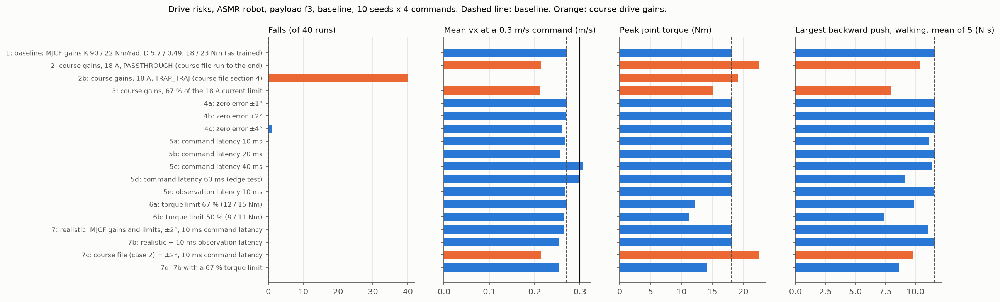

# Sim-to-real risks of the course motor drives

**Status:** tested in simulation (MuJoCo, CPU only). Nothing here is measured on board.

**Not verified:** The MuJoCo actuator model has no motor dynamics, no CAN jitter and no gearbox backlash.
The joint friction and armature are those of the ASMR MJCF. We did not check the drive trip limits (last table) on an XDrive MINI.
They come from the course config and the ODrive v0.5.1 defaults.

**Assumed:** Hip roll, hip yaw, hip pitch and knee use the 6512 motor. Ankle pitch and ankle roll use the 5010 motor.
Torque constants 0.067 and 0.0836 Nm/A from the course drive config.

## Setup

- Robot: the ASMR 2026 robot with the payload given by `--payload` (default `f3`: 47 parts, 4.14 kg, 16.35 kg in all).
- Policy: `policies/<name>` (`--policy`, default baseline) at 25 Hz, physics at 2 kHz, the training observation noise, and the standing start of `run.py`.
- `hw_risks.py` imports the `run.py` functions. With the baseline settings, it gives the same result as `run.py` `simulate()` (self-check).
- Commands: the 4 commands of `run.py`: stand, vx 0.3, yaw 0.5, and vx 0.2 + yaw 0.5. Each run lasts 20 s.
- Seeds: 10 seeds per command, so each case has 40 runs. The seed sets the sensor noise and the zero errors.
- Push test: the robot walks at 0.3 m/s. A 0.1 s push hits the torso, backward or to the left.
  A bisection finds the largest push without a fall in the next 3 s (resolution 0.375 N s).
- The 5 push seeds put the push at 3.0 to 3.4 s, so it hits 5 phases of one step. "Worst" is the smallest of the 5 values.
  A worst value of 0.0 means that the robot fell without a push before 6 s.
- Drive model: the drive does the PD. Torque = K × (target − measured position) − D × velocity, clipped to the joint limit.
  Case 1 uses the gains and limits of the MJCF (K 90 / 22 Nm/rad, D 5.7 / 0.49 Nm s/rad, 18.1 / 22.6 Nm, hip and knee / ankle), the values the policy trained with.
- Course gains: pos_gain 12.6 and vel_gain 0.223 (6512) give K = 100.6 Nm/rad and D = 8.0 Nm s/rad.
  pos_gain 20 and vel_gain 0.1 (5010) give K = 71.6 Nm/rad and D = 3.6 Nm s/rad.
  current_lim 18 A gives 18.1 Nm (6512) and 22.6 Nm (5010) at the joint.
- TRAP_TRAJ: the drive moves its setpoint to each new target at 4.2 rad/s and 2.1 rad/s² at most (joint side).
  These are trap_traj vel_limit 10 turn/s and accel 5 turn/s², divided by the gear ratio 15.
- Zero error: each joint gets a random offset, uniform in ±1°, ±2° or ±4°. The policy and the drive both see the offset position.
- Command latency: the drive gets the new target L ms after the policy computes it.
  Observation latency: the policy sees the sensor values of 10 ms before.
- Extra cases: 2b tests TRAP_TRAJ, because section 4 of the course config sets it. 5d finds the latency limit.
  7b to 7d combine the errors.
- Run time: 4.5 min on this machine.

Metrics:

- Falls: runs with a torso tilt above 0.78 rad or a large height drop, as in `run.py`. Mean time to fall uses only the runs that fall.
- vx: mean forward speed from 5 s to 20 s. Only runs without a fall count.
- Mean abs torque and peak torque: all 12 joints, from 1 s (after the start drop) to the end or the fall.
- Clipped steps: the share of physics steps where at least one joint asks for more than its limit.
- Action rate: the RMS change of the joint target between two policy steps, in rad. A higher value means a less smooth gait.

## Results

### Case 1: baseline

| Case | Falls | Mean time to fall (s) | vx at cmd 0.3 (m/s) | vx, yaw at cmd 0.2 + 0.5 | Mean abs torque (Nm) | Peak torque (Nm) | Clipped steps (%) | Action rate (rad) | Push back, worst / mean (N s) | Push left, worst / mean (N s) |
|---|---|---|---|---|---|---|---|---|---|---|
| 1: baseline: MJCF gains K 90 / 22 Nm/rad, D 5.7 / 0.49, 18 / 23 Nm (as trained) | 0 of 40 | - | 0.27 | 0.18, 0.53 | 2.44 | 18.1 | 2 | 0.100 | 11.6 / 11.6 | 6.4 / 6.8 |

### Case 2: course default gains, course current limit

| Case | Falls | Mean time to fall (s) | vx at cmd 0.3 (m/s) | vx, yaw at cmd 0.2 + 0.5 | Mean abs torque (Nm) | Peak torque (Nm) | Clipped steps (%) | Action rate (rad) | Push back, worst / mean (N s) | Push left, worst / mean (N s) |
|---|---|---|---|---|---|---|---|---|---|---|
| 1: baseline: MJCF gains K 90 / 22 Nm/rad, D 5.7 / 0.49, 18 / 23 Nm (as trained) | 0 of 40 | - | 0.27 | 0.18, 0.53 | 2.44 | 18.1 | 2 | 0.100 | 11.6 / 11.6 | 6.4 / 6.8 |
| 2: course gains, 18 A, PASSTHROUGH (course file run to the end) | 0 of 40 | - | 0.21 | 0.14, 0.48 | 3.20 | 22.6 | 4 | 0.099 | 8.2 / 10.4 | 6.0 / 7.2 |
| 2b: course gains, 18 A, TRAP_TRAJ (course file section 4) | 40 of 40 | 1.5 | - | -, - | 3.53 | 19.1 | 0 | 0.349 | 0.0 / 0.0 | 0.0 / 0.0 |

### Case 3: course default gains, 67 % of the current limit

| Case | Falls | Mean time to fall (s) | vx at cmd 0.3 (m/s) | vx, yaw at cmd 0.2 + 0.5 | Mean abs torque (Nm) | Peak torque (Nm) | Clipped steps (%) | Action rate (rad) | Push back, worst / mean (N s) | Push left, worst / mean (N s) |
|---|---|---|---|---|---|---|---|---|---|---|
| 1: baseline: MJCF gains K 90 / 22 Nm/rad, D 5.7 / 0.49, 18 / 23 Nm (as trained) | 0 of 40 | - | 0.27 | 0.18, 0.53 | 2.44 | 18.1 | 2 | 0.100 | 11.6 / 11.6 | 6.4 / 6.8 |
| 3: course gains, 67 % of the 18 A current limit | 0 of 40 | - | 0.21 | 0.14, 0.48 | 3.15 | 15.1 | 17 | 0.099 | 5.6 / 8.0 | 4.9 / 6.0 |

### Case 4: joint zero error (baseline gains)

| Case | Falls | Mean time to fall (s) | vx at cmd 0.3 (m/s) | vx, yaw at cmd 0.2 + 0.5 | Mean abs torque (Nm) | Peak torque (Nm) | Clipped steps (%) | Action rate (rad) | Push back, worst / mean (N s) | Push left, worst / mean (N s) |
|---|---|---|---|---|---|---|---|---|---|---|
| 1: baseline: MJCF gains K 90 / 22 Nm/rad, D 5.7 / 0.49, 18 / 23 Nm (as trained) | 0 of 40 | - | 0.27 | 0.18, 0.53 | 2.44 | 18.1 | 2 | 0.100 | 11.6 / 11.6 | 6.4 / 6.8 |
| 4a: zero error ±1° | 0 of 40 | - | 0.27 | 0.17, 0.53 | 2.45 | 18.1 | 2 | 0.100 | 11.6 / 11.6 | 6.0 / 6.5 |
| 4b: zero error ±2° | 0 of 40 | - | 0.27 | 0.17, 0.53 | 2.48 | 18.1 | 2 | 0.101 | 11.6 / 11.6 | 5.6 / 6.5 |
| 4c: zero error ±4° | 1 of 40 | 4.4 | 0.26 | 0.16, 0.52 | 2.63 | 18.1 | 2 | 0.104 | 11.6 / 11.6 | 4.1 / 6.5 |

### Case 5: latency (baseline gains)

| Case | Falls | Mean time to fall (s) | vx at cmd 0.3 (m/s) | vx, yaw at cmd 0.2 + 0.5 | Mean abs torque (Nm) | Peak torque (Nm) | Clipped steps (%) | Action rate (rad) | Push back, worst / mean (N s) | Push left, worst / mean (N s) |
|---|---|---|---|---|---|---|---|---|---|---|
| 1: baseline: MJCF gains K 90 / 22 Nm/rad, D 5.7 / 0.49, 18 / 23 Nm (as trained) | 0 of 40 | - | 0.27 | 0.18, 0.53 | 2.44 | 18.1 | 2 | 0.100 | 11.6 / 11.6 | 6.4 / 6.8 |
| 5a: command latency 10 ms | 0 of 40 | - | 0.27 | 0.17, 0.56 | 2.46 | 18.1 | 2 | 0.099 | 9.0 / 11.1 | 5.6 / 6.8 |
| 5b: command latency 20 ms | 0 of 40 | - | 0.26 | 0.17, 0.59 | 2.48 | 18.1 | 2 | 0.099 | 11.6 / 11.6 | 6.4 / 6.5 |
| 5c: command latency 40 ms | 0 of 40 | - | 0.31 | 0.20, 0.54 | 2.71 | 18.1 | 3 | 0.105 | 10.5 / 11.4 | 5.6 / 6.4 |
| 5d: command latency 60 ms (edge test) | 0 of 40 | - | 0.30 | 0.20, 0.58 | 2.79 | 18.3 | 3 | 0.107 | 6.4 / 9.2 | 5.6 / 6.2 |
| 5e: observation latency 10 ms | 0 of 40 | - | 0.27 | 0.17, 0.52 | 2.46 | 18.1 | 2 | 0.099 | 11.2 / 11.6 | 5.6 / 6.8 |

### Case 6: torque limit (baseline gains)

| Case | Falls | Mean time to fall (s) | vx at cmd 0.3 (m/s) | vx, yaw at cmd 0.2 + 0.5 | Mean abs torque (Nm) | Peak torque (Nm) | Clipped steps (%) | Action rate (rad) | Push back, worst / mean (N s) | Push left, worst / mean (N s) |
|---|---|---|---|---|---|---|---|---|---|---|
| 1: baseline: MJCF gains K 90 / 22 Nm/rad, D 5.7 / 0.49, 18 / 23 Nm (as trained) | 0 of 40 | - | 0.27 | 0.18, 0.53 | 2.44 | 18.1 | 2 | 0.100 | 11.6 / 11.6 | 6.4 / 6.8 |
| 6a: torque limit 67 % (12 / 15 Nm) | 0 of 40 | - | 0.27 | 0.18, 0.53 | 2.44 | 12.2 | 8 | 0.100 | 7.5 / 9.9 | 6.4 / 6.7 |
| 6b: torque limit 50 % (9 / 11 Nm) | 0 of 40 | - | 0.27 | 0.17, 0.53 | 2.44 | 11.3 | 20 | 0.099 | 7.1 / 7.3 | 6.4 / 6.7 |

### Case 7: combined realistic cases

| Case | Falls | Mean time to fall (s) | vx at cmd 0.3 (m/s) | vx, yaw at cmd 0.2 + 0.5 | Mean abs torque (Nm) | Peak torque (Nm) | Clipped steps (%) | Action rate (rad) | Push back, worst / mean (N s) | Push left, worst / mean (N s) |
|---|---|---|---|---|---|---|---|---|---|---|
| 1: baseline: MJCF gains K 90 / 22 Nm/rad, D 5.7 / 0.49, 18 / 23 Nm (as trained) | 0 of 40 | - | 0.27 | 0.18, 0.53 | 2.44 | 18.1 | 2 | 0.100 | 11.6 / 11.6 | 6.4 / 6.8 |
| 7: realistic: MJCF gains and limits, ±2°, 10 ms command latency | 0 of 40 | - | 0.26 | 0.17, 0.56 | 2.50 | 18.1 | 2 | 0.100 | 8.6 / 11.0 | 4.9 / 6.4 |
| 7b: realistic + 10 ms observation latency | 0 of 40 | - | 0.25 | 0.16, 0.56 | 2.52 | 18.1 | 2 | 0.099 | 11.6 / 11.6 | 4.9 / 6.2 |
| 7c: course file (case 2) + ±2°, 10 ms command latency | 0 of 40 | - | 0.21 | 0.14, 0.43 | 3.34 | 22.6 | 4 | 0.098 | 8.2 / 9.8 | 4.9 / 6.8 |
| 7d: 7b with a 67 % torque limit | 0 of 40 | - | 0.25 | 0.16, 0.56 | 2.52 | 14.1 | 8 | 0.099 | 7.5 / 8.6 | 4.9 / 6.3 |

### Drive limits that the simulation does not enforce

Above these values the drive stops with an error, and the joint goes limp. Overspeed: 25 rad/s at the joint. Regen: about 72 W per drive. Bus current: about 288 W per drive. Power is the mechanical power at one joint, without motor losses. The peaks include the runs that fall, up to the fall.

| Case | Peak joint speed (rad/s) | Peak power into one drive, regen (W) | Peak power from one drive (W) |
|---|---|---|---|
| 1 | 8.6 | 97 | 94 |
| 2 | 6.7 | 96 | 104 |
| 2b | 3.2 | 15 | 22 |
| 3 | 6.8 | 63 | 73 |
| 4a | 8.5 | 105 | 106 |
| 4b | 8.5 | 113 | 117 |
| 4c | 9.1 | 114 | 121 |
| 5a | 8.4 | 93 | 90 |
| 5b | 8.5 | 90 | 83 |
| 5c | 9.1 | 117 | 129 |
| 5d | 9.4 | 122 | 148 |
| 5e | 8.5 | 95 | 91 |
| 6a | 8.7 | 66 | 71 |
| 6b | 8.8 | 54 | 57 |
| 7 | 8.3 | 109 | 116 |
| 7b | 8.6 | 98 | 96 |
| 7c | 7.0 | 98 | 107 |
| 7d | 8.6 | 66 | 75 |

### All runs per command (falls, mean vx, mean yaw rate of the runs without a fall)

| Case | stand | vx 0.3 | yaw 0.5 | vx 0.2 + yaw 0.5 |
|---|---|---|---|---|
| 1 | 0 falls, vx -0.00, yaw +0.00 | 0 falls, vx +0.27, yaw -0.03 | 0 falls, vx -0.01, yaw +0.54 | 0 falls, vx +0.18, yaw +0.53 |
| 2 | 0 falls, vx -0.00, yaw -0.00 | 0 falls, vx +0.21, yaw -0.00 | 0 falls, vx -0.01, yaw +0.48 | 0 falls, vx +0.14, yaw +0.48 |
| 2b | 10 falls | 10 falls | 10 falls | 10 falls |
| 3 | 0 falls, vx -0.00, yaw -0.00 | 0 falls, vx +0.21, yaw -0.03 | 0 falls, vx -0.01, yaw +0.49 | 0 falls, vx +0.14, yaw +0.48 |
| 4a | 0 falls, vx -0.00, yaw +0.00 | 0 falls, vx +0.27, yaw -0.03 | 0 falls, vx -0.02, yaw +0.53 | 0 falls, vx +0.17, yaw +0.53 |
| 4b | 0 falls, vx -0.00, yaw +0.00 | 0 falls, vx +0.27, yaw -0.02 | 0 falls, vx -0.02, yaw +0.52 | 0 falls, vx +0.17, yaw +0.53 |
| 4c | 1 falls, vx -0.01, yaw +0.00 | 0 falls, vx +0.26, yaw -0.03 | 0 falls, vx -0.02, yaw +0.49 | 0 falls, vx +0.16, yaw +0.52 |
| 5a | 0 falls, vx -0.00, yaw +0.01 | 0 falls, vx +0.27, yaw -0.03 | 0 falls, vx -0.01, yaw +0.58 | 0 falls, vx +0.17, yaw +0.56 |
| 5b | 0 falls, vx -0.00, yaw +0.01 | 0 falls, vx +0.26, yaw -0.03 | 0 falls, vx -0.01, yaw +0.61 | 0 falls, vx +0.17, yaw +0.59 |
| 5c | 0 falls, vx -0.00, yaw +0.00 | 0 falls, vx +0.31, yaw +0.01 | 0 falls, vx -0.02, yaw +0.55 | 0 falls, vx +0.20, yaw +0.54 |
| 5d | 0 falls, vx -0.01, yaw +0.01 | 0 falls, vx +0.30, yaw +0.02 | 0 falls, vx -0.01, yaw +0.58 | 0 falls, vx +0.20, yaw +0.58 |
| 5e | 0 falls, vx -0.00, yaw +0.01 | 0 falls, vx +0.27, yaw -0.03 | 0 falls, vx -0.01, yaw +0.54 | 0 falls, vx +0.17, yaw +0.52 |
| 6a | 0 falls, vx -0.00, yaw +0.00 | 0 falls, vx +0.27, yaw -0.03 | 0 falls, vx -0.01, yaw +0.54 | 0 falls, vx +0.18, yaw +0.53 |
| 6b | 0 falls, vx -0.00, yaw +0.00 | 0 falls, vx +0.27, yaw -0.02 | 0 falls, vx -0.01, yaw +0.54 | 0 falls, vx +0.17, yaw +0.53 |
| 7 | 0 falls, vx -0.00, yaw +0.01 | 0 falls, vx +0.26, yaw -0.03 | 0 falls, vx -0.01, yaw +0.57 | 0 falls, vx +0.17, yaw +0.56 |
| 7b | 0 falls, vx -0.00, yaw +0.01 | 0 falls, vx +0.25, yaw -0.02 | 0 falls, vx -0.02, yaw +0.58 | 0 falls, vx +0.16, yaw +0.56 |
| 7c | 0 falls, vx -0.00, yaw -0.01 | 0 falls, vx +0.21, yaw -0.00 | 0 falls, vx -0.02, yaw +0.50 | 0 falls, vx +0.14, yaw +0.43 |
| 7d | 0 falls, vx -0.01, yaw +0.01 | 0 falls, vx +0.25, yaw -0.03 | 0 falls, vx -0.02, yaw +0.58 | 0 falls, vx +0.16, yaw +0.56 |

## Findings and recommendation

Not written yet. Read the tables above and write here: which cases fall, how the course gains and TRAP_TRAJ compare with the MJCF gains,
the zero and latency limits, the drive settings to put on the 12 leg drives, and the bench checks before the first walk.
The drive settings of the older BHL study (K 20, D 2, 6 Nm) do not apply to this robot. That study is in `archive/sim2sim_bhl/hw_risks.md`.

## Regen and the bus diode

**Status:** tested in simulation.
**Not verified:** the diode layout, the bus capacitance and the motor phase resistance.
**Assumed:** the phase resistance is 0.1 Ω for both motors. We found no datasheet value for the MAD M6C12 150KV or the MAD 5010 110KV.

- The course BOM has a Schottky diode module (MBRT400100, dual, common cathode) in the battery line. It probably joins the two 6S batteries.
- So regen current cannot flow back into the batteries. All 12 drives share one 24 V bus, and only their capacitors can take the energy.
- Capacitance: 5 × 100 µF per XDrive MINI (from photos), so 6 mF for 12 drives.
- Input power of one drive = τ × ω + 1.5 × R × I², with I = τ / (15 × Kt). Kt is 0.067 Nm/A (6512) and 0.0836 Nm/A (5010).
- The bus power is the sum over the 12 drives. When it is negative, the capacitors charge above the battery voltage. The script tracks this energy at each step.
- Start voltage: 25.2 V, a full 6S battery. We ignore the diode drop. The course config trips at 26 V (overvoltage).
- Runs: cases 1 and 7, 4 commands × 10 seeds, 20 s each. Runs that fall count up to the fall.

| Case | Lowest drive input power (W) | Drive current at 24 V (A) | Runs with a drive below −3 A | Lowest bus power, 12 drives (W) | Longest negative bus power (ms) | Largest energy into the capacitors (J) | Peak bus voltage from 25.2 V (V) |
|---|---|---|---|---|---|---|---|
| 1 | -48 | -2.0 | 0 of 40 | -25 | 66 | 0.55 | 28.59 |
| 7 | -61 | -2.5 | 0 of 40 | -30 | 64 | 0.73 | 29.65 |

