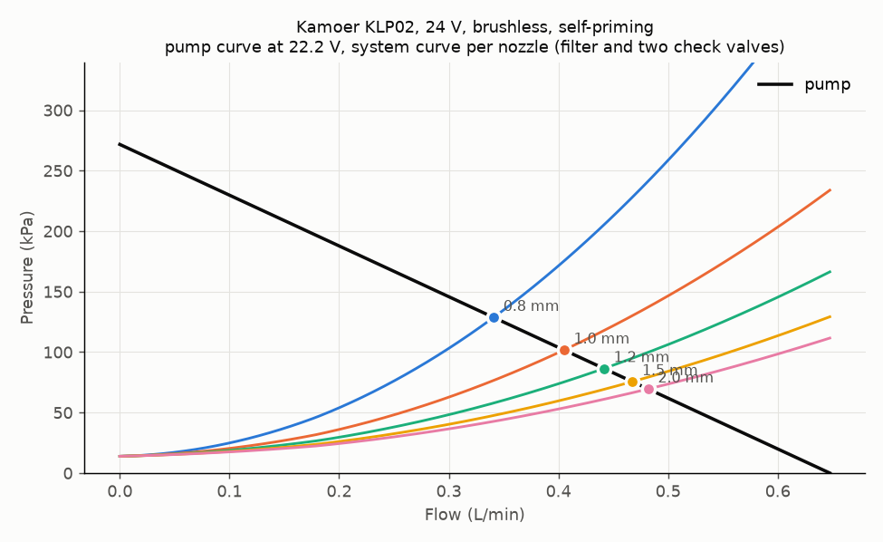
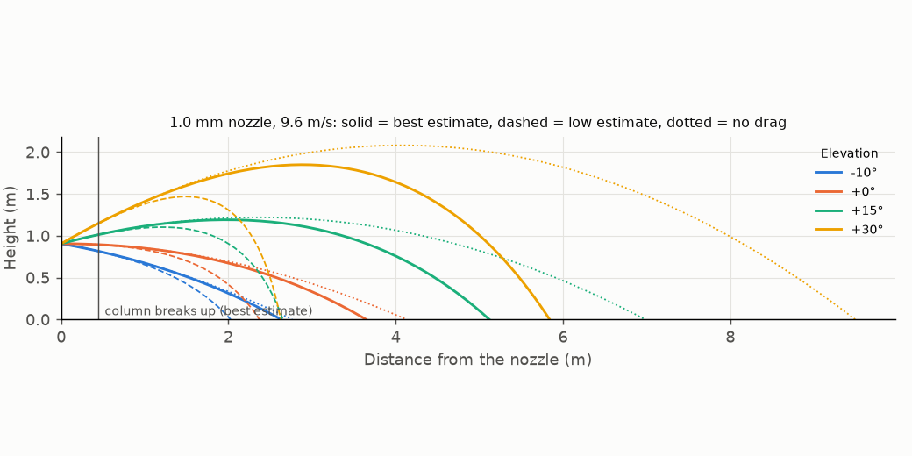

# Water system model

`water.py` computes the water system of design F3. It gives the pump and system curves, the flow at each nozzle and the jet speed. It also gives the range with air drag and jet break-up, the spray time and the recoil. It checks that the check valves hold the water when the pump is off, and it gives the fire size that the water can handle.
In F3 the 2 L water bag, the pump and its 6S pack ride on a trolley behind the robot ([docs/hardware/trolley.md](../../docs/hardware/trolley.md)).
The design document with the choices, the plumbing, the safety rules and the bench tests is [docs/hardware/water.md](../../docs/hardware/water.md).

**Status:** tested in simulation. Nothing is measured. The pump values come from the Kamoer data for the KLP02 24 V.

- **Not verified:** the KLP02 pump curve is an estimate from two datasheet points: 0.7 L/min free flow and 30 m of head at zero flow.
- **Assumed:** the pump speed follows the supply voltage. The main numbers are at 22.2 V, the nominal voltage of the 6S pack on the trolley.
- **Assumed:** the fitting losses, the nozzle coefficients (Cv 0.95, Cd 0.85) and the drag of the drop stream. Bench tests T3 and T4 measure them.
- **Assumed:** the stopped pump lets water through. Two check valves in series (20 kPa) hold the water of the bag.

## How to run

From the repository root:

```
uv run python sim/water/water.py
```

It takes about 5 s and writes the files in `results/`. The self-check takes about 3 s:

```
uv run python sim/water/water.py check
```

The script reads the heights, the bag volume and the hose from `docs/hardware/trolley.py`. It uses `aim/ballistics.py` for the drag value of the aim code.

## Key results

KLP02 at 22.2 V, 1.0 mm nozzle, filter and two check valves, empty bag, 3.0 m delivery hose:

| Value | Result |
|---|---|
| Flow | 0.41 L/min (6.7 g/s) |
| Jet speed at the nozzle | 9.6 m/s (9.2 m/s at 21.0 V, 10.6 m/s at 25.2 V) |
| Range to the floor at +15°, best / low estimate | 5.1 / 2.7 m |
| Longest range (+30°), best / low estimate | 5.8 / 2.6 m |
| Spray time, 1.95 L usable of the 2 L bag | 4.8 min |
| Recoil | 0.065 N |
| Pressure of the full bag at the nozzle, pump off | 9.3 kPa (robot standing), 16.6 kPa (robot on the floor). The two check valves open at 20 kPa. |
| Constant drag for `aim/ballistics.py` | 0.11 1/m |
| Jet speed against the pack voltage | v0 ≈ 9.6 m/s × (V / 22.2 V)^0.79 |



Figure 1. KLP02 at 22.2 V. Each coloured curve is the system curve of one nozzle. The dots are the operating points.



Figure 2. Jet paths of the 1.0 mm nozzle at four elevations. Solid: best estimate. Dashed: low estimate. Dotted: no drag.

## Files

| File | What it is |
|---|---|
| `water.py` | The model. `PUMPS` holds the pump data and its sources. |
| [`results/water.md`](results/water.md) | All tables: every nozzle and elevation, the sensitivity cases, the water held by the check valves, the fire capacity |
| `results/water.json` | The same numbers for other scripts. `docs/hardware/power_calc.py` reads the pump power and the spray time from it. |
| `results/curves_KLP02.png`, `results/jets.png`, `results/ranges.png` | The figures |

`results/water.md` also has the DWP-385 gear pump as a comparison, on the same F3 plumbing.

## Open points

- **Open:** the DMC-101 datasheet is not available yet. If the controller holds the pump speed, the jet speed does not follow the pack voltage.
- **Open:** the mission simulation still uses the F2 jet and tank (0.39 L/min, 9.2 m/s, 0.749 L). The F3 values are 0.41 L/min, 9.6 m/s and 1.95 L.

## Licence

Code: MIT (root `LICENSE`). This README and the result files: CC BY-SA 4.0.
